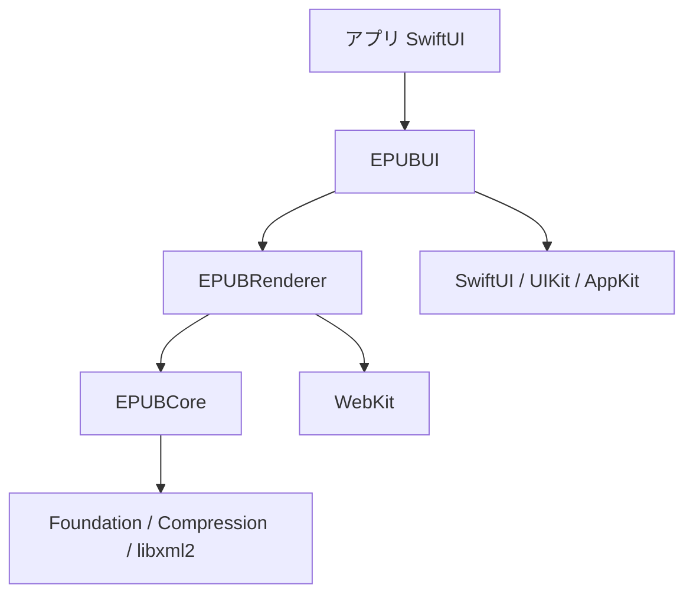

# 00. 概要とレイヤー構成

EPUB-Swift は iOS / macOS 向けの EPUB 3 ビューワーライブラリである。描画は WKWebView に任せ、
コンテナ解析・位置表現・検索・ページ分割の管理・SwiftUI 統合をライブラリが担う。

本ドキュメント群は実装前の設計を記す。各ファイルの役割:

| ファイル | 内容 |
|---|---|
| 00-overview.md | 目的、決定事項、非目標、レイヤー構成、横断的な方針 |
| 01-core.md | EPUBCore: ZIP、OPF、nav、難読化、CFI、検索 |
| 02-rendering.md | EPUBRenderer: WKWebView、URL スキーム、CSS、JS ブリッジ、ページ分割、演出 |
| 03-api.md | 公開 API（型、プロトコル、SwiftUI View） |
| 04-roadmap.md | マイルストーン、テスト方針、検証項目 |

## 1. 目的

自分のリーダーアプリに組み込むための、次を満たす EPUB 表示基盤を作る。

- 海外を含む一般的な EPUB 3 を崩さず表示する（出版社 CSS はリーダー側のスタイルに正規化してよい）。
- 横書きと縦書き（ルビ、圏点、縦中横）を同等に扱う。固定レイアウト（FXL）と見開きにも対応する。
- 書籍を開いてから最初のページが出るまでが速く、総ページ数が安定し、ページめくりが滑らかで、メモリとプロセスが安定している。
- テキスト選択・辞書引き・全文検索・ハイライト・しおり・脚注ポップアップ・内部リンク・画像拡大を提供する。
- 表示設定、ページめくり演出、ジェスチャをアプリ側で差し替えられる。

## 2. 決定事項

設計に先立って確定した判断。理由は該当ファイルに記す。

| 項目 | 決定 |
|---|---|
| 描画エンジン | WKWebView（ネイティブ組版は採用しない。Apple Books も WebKit で描画している） |
| 対応 OS | iOS 27 / macOS 27 以降 |
| UI | SwiftUI ファースト。内部で UIViewRepresentable / NSViewRepresentable を使う |
| 依存 | Apple 標準のみ（Foundation、Compression、CryptoKit、WebKit、libxml2）。SwiftPM 依存は追加しない |
| 利用者 | 自分のアプリ専用。API の後方互換は重視しない |
| ターゲット | EPUBCore / EPUBRenderer / EPUBUI の 3 分割 |
| EPUB バージョン | EPUB 3 のみ。NCX と OPF 2.0 固有の要素は読まない |
| 壊れた XHTML | 努力目標。`XMLParser` で読めない文書だけを Core が libxml2 で修復して整形式 XML として配信する。直らなければ `text/html` で開いて位置精度を諦める。整形式な文書には手を加えない |
| 表示モード | paged（ページめくり）と見開き。連続スクロールは対象外 |
| WebView 構成 | 表示用 1 つ + 事前ページ化用 1 つ。めくり演出はスナップショット画像で行う |
| リソース配信 | WKURLSchemeHandler で ZIP から直接配信。ディスクに展開しない |
| 位置表現 | EPUB CFI を正とする |
| 永続化 | アプリ側。ライブラリは Codable な値型と描画だけを提供する |
| 検索 | EPUBCore で XHTML をパースして検索。WebView を使わない |
| コンテンツ JS | 無効化。ライブラリのブリッジ JS だけが動く |
| CSS | 自前で書く。Readium CSS は同梱しない（構造の考え方だけ参考にする） |
| ページ番号 | 全章をバックグラウンドで事前ページ化し、完了までは文字数からの推定値を出す |
| フォント難読化 | IDPF / Adobe 方式に対応。DRM は対象外 |
| 脚注判定 | `epub:type="noteref"` のみ |
| 選択メニュー | ライブラリがシステムの編集メニューにアプリ指定の項目を追加する |
| 演出・ジェスチャ | 標準をライブラリが持ち、アプリが無効化・差し替えできる |
| 壊れた EPUB | container.xml と OPF が読めれば開く。欠落は警告として記録して続行する |
| アクセシビリティ | WKWebView 標準の読み上げに任せる。演出中に VoiceOver を壊さないことだけ保証する |
| macOS 入力 | キーボード、トラックパッドのスワイプ、ウィンドウリサイズ追従 |

## 3. 非目標

- EPUB 2（NCX 目次、OPF 2.0）
- 連続スクロール表示
- メディアオーバーレイ（SMIL）、埋め込み audio / video、コンテンツ側 JavaScript
- DRM（Adobe ADEPT、LCP など）
- ネイティブ組版（TextKit 2 / Core Text）。将来の差し替え点として `Renderer` の境界だけ残す
- ハイライト・しおり・読書位置の永続化

## 4. レイヤー構成

| ターゲット | 責務 | 依存 | 主な型 |
|---|---|---|---|
| EPUBCore | ZIP 読み出し、container.xml / OPF / nav の解析、encryption.xml と難読化解除、CFI の解析・生成・比較、XHTML の軽量 DOM、テキスト抽出と全文検索、警告の収集 | Foundation, Compression, libxml2 | `EPUBContainer`, `Publication`, `CFI`, `SearchService` |
| EPUBRenderer | WKWebView の構成、URL スキームハンドラ、CSS 注入、ブリッジ JS、ページ分割とページ番号、スナップショット、事前ページ化、FXL と見開きのラッパー文書、リンク・脚注・画像・選択のイベント化 | EPUBCore, WebKit | `ReaderSession`, `ReaderSettings`, `BookPagination`, `ReaderEvent` |
| EPUBUI | SwiftUI View、ジェスチャ、ページめくり演出、編集メニューへの項目追加、キーボード入力、リサイズ追従 | EPUBRenderer, SwiftUI | `EPUBReaderView`, `PageTransition`, `SelectionAction` |

製品（product）は 3 ターゲットを個別に公開し、さらに全部を再公開する umbrella `EPUB` を用意する。
アプリは通常 `import EPUB` だけでよい。

### 依存方向の原則

- EPUBCore は UI フレームワークも WebKit も import しない。macOS の `swift test` で WebView なしに検証できる。
- EPUBRenderer は SwiftUI を import しない。UIKit / AppKit の WKWebView を扱うだけにする。
- EPUBUI は WebKit の型を公開 API に出さない。アプリが WKWebView を直接触る必要をなくす。

## 5. 横断的な方針

### 5.1 並行性

Swift 6 の strict concurrency と `ApproachableConcurrency` を前提にする。

- EPUBCore のモデルは `Sendable` な値型。`EPUBContainer` と `SearchService` は actor。
- EPUBRenderer の WebView を触る型は `@MainActor`。ZIP 展開や XHTML パースは actor 側で行い、結果だけを main に渡す。
- 事前ページ化は WebView を使うので main actor 上で動くが、1 章ずつ `await` で区切り、表示の操作を優先させる。

### 5.2 エラーと警告

- 開けないときだけ `EPUBError` を投げる（ZIP として読めない、container.xml がない、OPF が読めない）。
- それ以外の仕様違反は `PublicationWarning` として `Publication.warnings` に積み、処理を続ける。
- 表示時のエラー（リソース欠落、WebContent プロセス終了）は `ReaderEvent.error` でアプリに通知し、可能なら自動復旧する。

### 5.3 識別子

- 開いた EPUB ごとにライブラリが `PublicationID`（UUID）を払い出し、URL スキームとキャッシュのキーにする。
  `dc:identifier` は同じ値を持つ別ファイルがあり得るのでキーにしない。
- spine 内の位置は `spineIndex`（0 始まり）と OPF 内 href の両方で表す。CFI の最初のステップから spineIndex を導ける。

### 5.4 ログ

`os.Logger` を `subsystem = "EPUB"` でターゲットごとの category に分けて使う。
JS ブリッジのメッセージは debug レベルで全件記録できるようにする。
