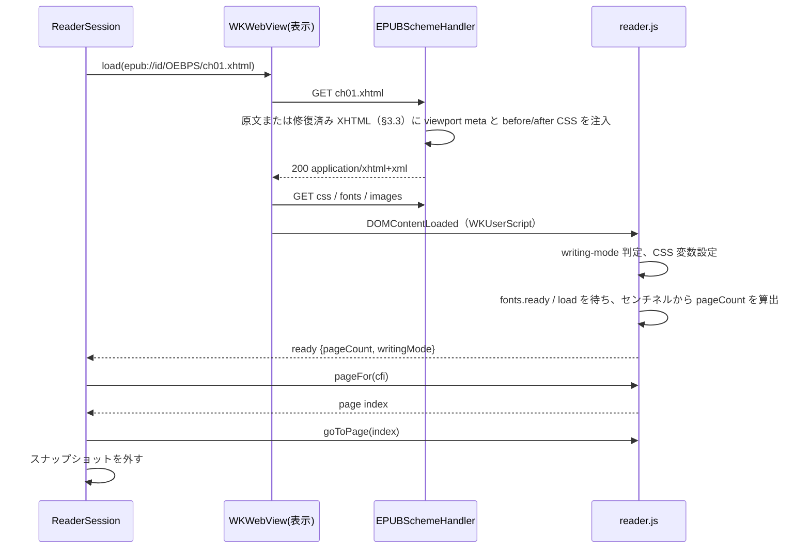

# 02. EPUBRenderer

WKWebView で spine item を描画し、ページ分割・位置・イベントを Swift 側に提供する層。
SwiftUI は import せず、UIKit / AppKit の WKWebView を扱う。

## 1. WebView の構成

表示用 WebView を 1 つ、事前ページ化用 WebView を 1 つ持つ。表示用は常に「現在の spine item」を 1 文書
読み込んでいる。ページめくりは文書内ではスクロール、章をまたぐときは次の文書の読み込みで行い、
いずれもスナップショット画像で演出する（§7）。

### 1.1 `WKWebViewConfiguration`

| 設定 | 値 | 理由 |
|---|---|---|
| `setURLSchemeHandler(_:forURLScheme: "epub")` | `EPUBSchemeHandler` | ZIP から直接配信 |
| `defaultWebpagePreferences.allowsContentJavaScript` | `false` | コンテンツ側 JS を止める。`WKUserScript` は動く |
| `userContentController` | `reader.js` を `.atDocumentEnd`、専用 `WKContentWorld` で登録 | 将来コンテンツ JS を許可しても分離される |
| `suppressesIncrementalRendering` | `true` | ページ化前の途中描画を見せない |
| `dataDetectorTypes`（iOS） | `[]` | 電話番号などの自動リンク化を止める |
| `allowsInlineMediaPlayback` | 既定のまま | 対象外機能なので触らない |
| `isInspectable` | DEBUG のみ `true` | Safari Web Inspector で確認する |

WebView 側:

- iOS: `scrollView.isScrollEnabled = false`、`bounces = false`、`contentInsetAdjustmentBehavior = .never`、
  `allowsLinkPreview = false`、`allowsBackForwardNavigationGestures = false`。
- macOS: `allowsBackForwardNavigationGestures = false`、`allowsMagnification = false`（FXL では `true`）。
- 背景色はテーマの背景色に合わせ、`isOpaque = false`（iOS）にして読み込み中の白フラッシュを避ける。

### 1.2 3 ページ幅のフレーム

表示用 WebView のフレームは可視領域の 3 ページ分（横書きなら幅 3 倍、縦書きなら高さ 3 倍）にし、
親ビューでクリップして中央の 1 ページだけを見せる。WebView は自分のフレーム全体を描画するので、
前後のページがスクロールなしに `takeSnapshot(with:)` の `rect` 指定で撮れる。
これでめくり開始時に次ページの画像を即座に用意でき、ドラッグ追従の演出が成り立つ。

章の境界では前後のページは別文書なので、事前ページ化用 WebView がその章を読み込んで先頭 / 末尾ページを撮る（§8.3）。

見開き時は「ページ」を「見開き 1 面」と読み替え、フレームは見開き 3 面分になる。

縦書きのフレームは高さを 3 ページ分にし、幅はページ幅に固定する（段は縦に積まれるため、幅を広げる理由がない）。

フレームが 3 ページ分あるため、文書の `scrollWidth`（縦書きは `scrollHeight`）はビューポート幅の 3 ページ分が下限になり、
2 ページ以下の章でもページ数を 3 と数えてしまう。ページ数は `scrollWidth` ではなく末尾センチネルの位置から求める（§5.1）。
先頭ページ表示時は WebView のオフセットを 0 にし、クリップの左 1 ページ分は空白（背景色）になる。
末尾ページでも同様で、スクロール位置は文書末尾でクランプされるため、センチネル位置から求めたページ数で
ページ i の `scrollLeft = i * pageWidth` を計算し、クランプには依存しない（05-spike-results §2.3）。

実装では WebView のフレームを 3 スロットに分け、`goToPage` が「可視スロット」（0〜2）を返す。
Swift はフレームの `origin.x` を `-visibleSlot * pageWidth` に置いてそのスロットをクリップ内に合わせる。
先頭ページはスロット 0、末尾ページはスロット 2、それ以外はスロット 1 に置くことで、文書の両端でも前後ページを撮れる範囲を最大にする。

iOS では、文書側の `scrollLeft` / `scrollTop` の設定を UI プロセスが非同期に `UIScrollView.contentOffset` へ反映し、
その際に古い `contentSize` でクランプすることがある（画像の遅延読み込みで文書が伸びている最中に連続でめくった場合）。
すると文書が報告するページと実際に見えている位置がずれる。`goToPage` は設定後の `scrollLeft` / `scrollTop` を戻り値に含め、
Swift 側は iOS で `scrollView.setContentOffset(_:animated: false)` を同じ値で呼んで同期する（M1 で発見。macOS には不要）。

## 2. URL スキーム

### 2.1 URL 形式

```
epub://<publicationID>/<コンテナ内パス>
epub://<publicationID>/_reader/css/<name>.css
epub://<publicationID>/_reader/fonts/<name>
epub://<publicationID>/_reader/spread?left=<path>&right=<path>
```

- `publicationID` はライブラリが払い出した UUID（00-overview §5.3）。`EPUBSchemeHandler` は
  `PublicationRegistry` でこの ID から `EPUBContainer` を引く。
- `_reader/` 以下はライブラリが生成するリソース。コンテナ内に同名のパスがあっても `_reader/` を優先する。
- `Origin` が `epub://<publicationID>` になるので、同じ書籍のリソースは同一オリジンとして扱われ、
  iframe（§6）や `@font-face` が CORS に引っかからない。

### 2.2 `EPUBSchemeHandler`

`WKURLSchemeHandler` の実装。要求ごとに:

1. パスを解決し、`EPUBContainer.data(at:)` で読む（難読化解除込み）。
2. `Content-Type` は manifest の `media-type` を使い、なければ拡張子から推定する。
3. spine item の XHTML なら §3 の注入を行ってから返す。
4. 見つからなければ 404 相当の `URLResponse` を返し、`ReaderEvent.warning(.missingResource)` を出す。
5. `webView(_:stop:)` で停止要求された task には応答しない（応答すると WebKit が例外を投げる）。

読み出しは actor 側で行い、`urlSchemeTask.didReceive` は main actor で呼ぶ。

## 3. CSS 注入

### 3.1 レイヤー

Readium CSS の before / after の考え方を借り、自前の 2 ファイルを持つ。

| ファイル | 位置 | 役割 |
|---|---|---|
| `reader-before.css` | `<head>` の先頭 | ページ分割（多段組）、ページサイズの CSS 変数、既定の余白リセット、画像の最大サイズ、`ruby` の既定 |
| `reader-after.css` | `<head>` の末尾 | ユーザー設定（フォント、サイズ、行間、余白、テーマ色）と、`!important` で出版社 CSS を上書きする規則 |

出版社 CSS はその間に残る。before で土台を作り、after で読者の設定を勝たせる。

2 つの CSS と `reader.js` は EPUBRenderer ターゲットの `Reader/` フォルダに `.copy` リソースとして同梱する。
フォルダ名を `Resources` にすると iOS の codesign がバンドル内の同名ディレクトリを拒否するため、この名前は使わない。

### 3.2 注入方法

`EPUBSchemeHandler` が XHTML のバイト列を文字列として読み、`<head>` の直後に before の `<link>` を、
`</head>` の直前に after の `<link>` を文字列挿入する。`<head>` がなければ `<html>` 直後に `<head>` ごと作る。
JS で後から挿入する方法はカスケード順と初回描画のちらつきで劣るので採らない。

同時に `<head>` へ `<meta name="viewport" content="width=device-width, initial-scale=1"/>` を注入する。
リフロー文書は通常この meta を持たず、iOS の WKWebView はそれがないとレイアウトビューポートを 980 px にして
多段組を縮小表示し、ページ境界が崩れる（05-spike-results §3）。文書が自前の viewport meta を持つ場合（FXL 文書）はそのまま通し、
FXL 文書に meta がなければ警告する（FXL 仕様では必須）。

### 3.3 整形式でない XHTML

WebKit は XML 構文エラーのある文書を `application/xhtml+xml` で受け取ると `parsererror` を立て、エラー箇所までしか描画しない。
EPUBCore が `malformedXHTML` を記録した spine item は、Core が libxml2 で回復して整形式に直列化した「修復済み XHTML」
（01-core §4.1）を、原文の代わりに `application/xhtml+xml` で配信する。WebKit は XML パーサで読むので DOM が Core の木と一致し、
CFI が揃う。CSS 注入（§3.2）は修復済み XHTML に対して行う。

Core が修復を諦めた文書（修復済み XHTML も XML として読めないもの）は、原文を `Content-Type: text/html` で配信して
「可能な限り開く」。この文書では WebKit の DOM と Core の木が一致しないため、`reader.js` は CFI の解決で
文字列アサーションを優先する（01-core §5.3）。検索結果やハイライトの位置が近傍にずれることは受け入れる。

`text/html` で WebKit に読ませて libxml2 の HTML パーサと DOM を揃える方式は採らない。
SDK の libxml2 は HTML5 の木構築規則を持たず、表や交差タグで要素インデックスがずれる（05-spike-results §2.5）。

### 3.4 ページ分割の CSS

横書き（`writing-mode: horizontal-tb`）:

```css
:root {
  --reader-column-width: calc(var(--reader-page-width) - 2 * var(--reader-margin-h));
  --reader-column-gap: calc(2 * var(--reader-margin-h));
}
html {
  box-sizing: content-box;
  width: var(--reader-column-width);                                  /* 内容幅 = ページ幅 - 左右余白 */
  height: calc(var(--reader-page-height) - 2 * var(--reader-margin-v));
  padding: var(--reader-margin-v) var(--reader-margin-h);             /* 余白は html の padding */
  overflow: hidden;
  column-width: var(--reader-column-width);
  column-gap: var(--reader-column-gap);                               /* 段間 = 左右余白 2 つ分 */
  column-fill: auto;
}
body { margin: 0; padding: 0; }
```

余白は `body` の padding ではなく `html` の padding と `column-gap = 2 × 左右余白` で作る。
`body` に padding を付けると最初の段にしか余白が付かず、2 段目以降のページは余白なしで始まる。
`html` の padding なら全段（全ページ）に同じ余白が付き、段の幅 + 段間 = ページ幅となってページ i の
`scrollLeft = i * pageWidth` がそのまま成り立つ（M1 で変更）。

縦書き（`writing-mode: vertical-rl`。M2 で変更）:

```css
:root { --reader-column-height: calc(var(--reader-page-height) - 2 * var(--reader-margin-v)); }
html[data-reader-writing-mode="vertical"] {
  /* width / height / padding は横書きと同じ。段の軸だけが変わる */
  column-width: var(--reader-column-height) !important;      /* 縦書きでは column-width が縦方向のサイズになる */
  column-gap: calc(2 * var(--reader-margin-v)) !important;   /* 段間 = 上下余白 2 つ分 */
}
```

縦書きでも余白は `html` の padding で作り、段の高さ + 段間 = ページ高さにして
ページ i の `scrollTop = i * pageHeight` を成り立たせる（横書きの `scrollLeft = i * pageWidth` と対称）。
`writing-mode` 自体は強制しない。段がページの縦方向に積まれ、1 段 = 1 画面になる。行は段の境界で分断されない。
ページ分割に関わる `html` の宣言はすべて `!important` にする（出版社 CSS が `html { width: 100% }` などを持つため）。

`writing-mode` は強制しない。読み込み後に `getComputedStyle(document.documentElement).writingMode` を読み、
縦書き（`vertical-*` / `sideways-*`）なら `html` に `data-reader-writing-mode="vertical"` を付けて上の CSS を効かせ、
スクロール軸を y に切り替える（`reader.js` が判定して `ready` と `layout` の `writingMode` で Swift に報告する。
Swift 側は `WritingMode` 列挙型で受ける）。出版社 CSS が `body` にだけ `writing-mode` を付けている場合は `html` に昇格させる。
Swift は縦書きの通知を受けるとフレームを 3 ページ分の高さに組み替える（§1.2）。

縦書きの見開きは多段組では表現できない（段が縦に積まれるため 2 面を横に並べられない）。
縦書き + 見開きは §6 のラッパー文書で 2 つの iframe を並べて実現する。横書きの見開きは
`--reader-page-width` を 2 ページ分にして段を 2 本見せるだけでよい。

### 3.5 ユーザー設定の CSS 変数

| 変数 | 設定元 |
|---|---|
| `--reader-font-size` | `ReaderSettings.fontScale`。`html { font-size: calc(100% * var(--reader-font-size)) }` として出版社の `rem` / `em` 比率を保つ |
| `--reader-line-height` | `ReaderSettings.lineHeight`。`body` と段落に適用 |
| `--reader-margin-h` / `--reader-margin-v` | `ReaderSettings.pageMargins` |
| `--reader-fg` / `--reader-bg` / `--reader-link` | `ReaderSettings.theme` |
| `--reader-font-family` | `ReaderSettings.font`。`html[data-reader-font="override"] *` に `!important` で適用。`.publisher` のときは属性を付けない |

ナイトテーマでは `img, svg { filter: brightness(0.85) }` と `color-scheme: dark` を付ける。

### 3.6 フォント

- `.system(name)` は `font-family` に名前を書くだけ。
- `.custom(FontResource)` はアプリから受け取ったフォントファイルを `epub://<id>/_reader/fonts/<name>` で配信し、
  `reader-after.css` に `@font-face` を生成する。
- 出版社の `@font-face` は難読化解除済みで配信されるので WebKit がそのまま使う。

## 4. ブリッジ JS（`reader.js`）

ライブラリ同梱の 1 ファイル。専用 `WKContentWorld`（`reader`）で動き、`window.__epubReader` に API を置く。

### 4.1 Swift → JS

`callAsyncJavaScript(_:arguments:in:in:)` で呼び、戻り値を受け取る。

| 関数 | 役割 |
|---|---|
| `layout({pageWidth, pageHeight, columnsPerPage, margins, ...})` | CSS 変数を更新し、`writing-mode` を判定して `{pageCount, writingMode}` を返す。`writingMode` は CSS の値（`horizontal-tb` / `vertical-rl` / `vertical-lr`） |
| `goToPage(index)` | ページ数を測り直してから index をクランプし、スクロール位置を設定する。`{pageIndex, slot, pageCount, scrollLeft, scrollTop}` を返す（§1.2 のスロットと iOS の同期に使う） |
| `captureAnchor(slot, margins)` / `pageForAnchor()` | M1〜M2 の暫定。可視ページ先頭のテキスト位置（`caretRangeFromPoint`）か要素を reader world 内の DOM アンカーとして保持し、再レイアウト後にそれを含むページを返す。縦書きではページ先頭は右上で、スロットのオフセットは y 方向（M2）。M3 で `cfiForPage` / `pageFor(cfi)` に置き換える |
| `pageForFragment(id)` | 文書内リンクと目次の `#fragment` が指す要素のページを返す |
| `pageFor(cfi)` | CFI を Range に解決し、`getBoundingClientRect` からページ番号を返す |
| `cfiForPage(index)` | そのページの先頭に見えるテキスト位置の CFI を返す（`caretRangeFromPoint` を使う） |
| `cfiForVisibleRange()` | 現在ページの先頭と末尾の CFI 範囲を返す |
| `setHighlights([{id, cfiRange, color, style}])` | CSS Custom Highlight API（`CSS.highlights`）で描画する。DOM を変更しない |
| `rectsFor(cfiRange)` | WebView 座標の矩形配列を返す（ハイライトのメニュー位置に使う） |
| `applySettings({...})` | CSS 変数とフォント上書き属性を更新する。必要なら `layout` を再実行する |
| `currentSelection()` | 選択中の `{cfiRange, text, rects}` を返す |
| `clearSelection()` | 選択を解除する |

### 4.2 JS → Swift

`WKScriptMessageHandlerWithReply` を `reader` という名前で登録する。メッセージは `{type, payload}` の JSON。

| type | payload | 発火 |
|---|---|---|
| `ready` | `{writingMode, readyState, href}` | 文書の読み込み完了（`layout` は Swift が続けて呼ぶ）。`href` は文書の `location.href`。Swift は `load` ごとに URL へ一意なクエリ `__reader_load=<n>` を付けるので、同じ章を続けて読み込んだときも、置き換えられた古い文書の `ready` を取り違えずに捨てられる（M2 で変更。フラグメントでは同一文書ナビゲーションになり `reader.js` が再実行されないのでクエリを使う。スキームハンドラは `url.path` で解決するためクエリは無視される）。`.atDocumentEnd` の `WKUserScript` は `DOMContentLoaded` 相当（`readyState = "interactive"`）で動き、画像とフォントはまだ読み込まれていない。`reader.js` は `document.fonts.ready` と `load` を待ってから初回 `layout` を確定し `ready` を送る。それ以降の増減は `pageCountChanged` で補正する |
| `pageCountChanged` | `{pageCount}` | 画像読み込みやフォント読み込みで高さが変わったとき |
| `link` | `{href, isExternal}` | `a` のクリック（`preventDefault` 済み） |
| `noteref` | `{href, html, text}` | `a[epub\:type~="noteref"]` のクリック。同一文書内なら参照先要素の `innerHTML` と `textContent` を同梱する |
| `imageTap` | `{src, alt, rect}` | `img` または `svg image` のタップ |
| `selectionChanged` | `{cfiRange, text, rects}` または `null` | `selectionchange` |
| `tap` | `{x, y}` | リンクでも画像でもない場所のタップ。タップゾーン判定に使う |

`a` のクリックは常に `preventDefault` し、ナビゲーションは Swift が決める。
`WKNavigationDelegate.decidePolicyFor` でも初回読み込み以外は `.cancel` にして二重に防ぐ。

### 4.3 CFI の JS 実装

EPUBCore と同じ規則（01-core §5）で DOM を数える。WebKit の DOM には コメントノードが残るので
`nodeType` が ELEMENT / TEXT 以外は読み飛ばし、隣接テキストは結合して数える。
`Range` ↔ CFI の変換と、ID アサーションによる復元を実装する。

## 5. ページ分割とページ番号

### 5.1 章内のページ

`layout` は `body` の末尾に空のセンチネル要素（`<span id="__reader_end"></span>`、`display: inline-block; width: 0; height: 0`）を置き、
その `getBoundingClientRect()` と現在のスクロール位置から文書末尾の座標を求め、
`pageCount = floor(endX / pageWidth) + 1`（縦書きは `endY / pageHeight`）とする。

`scrollWidth` は使わない。3 ページ幅のフレーム（§1.2）ではビューポート幅が下限になり、2 ページ以下の章で 3 を返す
（05-spike-results §2.3）。縦書きの `scrollHeight` は 3 ページ高フレームでもページ高の整数倍になるが、同じ理由で短い章では
下限に張り付くので、横書きと同じくセンチネルで統一する。

最後の段が空になる端数は `column-fill: auto` で起きないが、画像の遅延読み込みで増減するので `pageCountChanged` を監視する。

Swift 側が持つ `chapterPageCount` は、この通知の到着前は古い値になりうる。そのため `goForward()` は
「現在ページが既知のページ数の最後だから次章へ」とは判断せず、まず文書に `goToPage(current + 1)` を要求する。
`goToPage` はその場でページ数を測り直してからクランプするので、ページが増えていれば章内で進み、
動けなかった（戻り値の `pageIndex` が変わらない）ときだけ次の線形 spine item を読み込む（M1 で変更）。

### 5.2 書籍全体のページ番号

`BookPagination` は spine 順に各章の `pageCount` を持ち、章 i のページ j を `offset(i) + j` と番号付けする。
値は 2 種類ある。

- 確定値: 事前ページ化（§8）で計測した章、または表示用 WebView 自身が表示した章（表示側の計測もキャッシュに書く）。
- 推定値: 未計測の章。`SpineItem.characterCount` と、計測済み章の「1 ページあたり文字数」から推定する。
  計測済み章がなければ 1 ページ 600 文字（横書き）/ 500 文字（縦書き）を初期値にする。

M2 で決めた推定の規則: 比率を学習するのは 500 文字以上の計測済み章だけ（表紙や扉のような「画像と数語で 1〜2 ページ」
の章が比率を下げ、全章の推定を数倍に膨らませるため）。比率は 50〜10000 文字/ページにクランプする。
非線形（`linear="no"`）の spine item は番号付けに含めない。

`BookPagination.isEstimated` が false になるのは全章の計測が終わったときだけ。UI は推定中であることを
表示できる（`estimatedChapterCount`）。キャッシュのキーは `(publicationID, layoutKey)`。`layoutKey` は
整数に丸めたページサイズ、見開き有無、`ReaderSettings.layoutKey`（フォント、サイズ、行間、余白）。テーマ色は含めない。
`ReaderSession.totalProgression` は `BookPagination` のページ番号から求める（確定前は推定値ベース）。

### 5.3 位置の復元

読書位置は常に CFI（表示ページ先頭の `cfiForPage`）で持つ。設定変更、リサイズ、章の再読み込みの後は
`pageFor(cfi)` で同じテキストが含まれるページに戻す。ページ番号は復元の手段には使わない。

M1〜M2 の暫定: CFI は M3 で入るため、それまでは `reader.js` が可視ページ先頭の DOM アンカー（§4.1 `captureAnchor`）を
保持し、同じ文書の再レイアウト後に `pageForAnchor()` で戻す。アンカーは文書の再読み込みをまたげないので、
章の再読み込み時は章内の進捗率（`currentPageIndex / (chapterPageCount - 1)`）で近似する。
アプリに公開する位置は M3 まで spine index とページ index（03-api §3.2）。

再レイアウト中の見た目（M2）: `ReaderSession` は再レイアウトの前に可視ページのスナップショットを撮って
`relayoutSnapshot` に置き、位置を復元し終えたら nil に戻す。表示用 WebView のページサイズ変更も再レイアウトの
操作の中で行うので、中間サイズで流し込まれた文書が画面に出ることはない。EPUBUI はこの画像を WebView の上に重ね、
nil になったらクロスフェードで外す（03-api §4.5）。

## 6. FXL と見開き

### 6.1 ラッパー文書

FXL の spine item、および縦書き + 見開きのときは、ライブラリが生成する HTML
`epub://<id>/_reader/spread?left=...&right=...` を表示用 WebView に読み込む。
ラッパーは 1 つまたは 2 つの `iframe` を横に並べ、各 iframe に spine item を読み込む。
同一オリジンなので親文書の `reader.js` から iframe の DOM を触れる。

- FXL: 各 iframe は `<meta name="viewport">` の `width` / `height` の大きさで作り、
  CSS `transform: scale()` で可視領域に収める。見開きなら 2 面の合計を収める。
- 縦書き + 見開き: 同じ spine item を 2 つの iframe に読み込み、左右で隣接ページに `scrollTop` を合わせる。
  文書を 2 回レイアウトするのでメモリは 2 倍になる。選択は iframe をまたげない（制限として受け入れる）。

### 6.2 見開きの組み立て

`SpreadBuilder` が spine と `ReaderSettings`、可視領域の縦横比から「面の列」を作る。

- `rendition:spread` が `none` または可視領域が縦長なら単ページ。
- `page-spread-left` / `right` / `center` を尊重する。指定がなければ `page-progression-direction` から
  右綴じ（rtl）なら最初のページを左、左綴じなら右に置く。
- `center` は単独の面にする。
- リフロー + 横書きの見開きは多段組 2 本（§3.4）でラッパーを使わない。

### 6.3 ズーム

FXL のときだけ iOS の `scrollView.pinchGestureRecognizer` と macOS の `allowsMagnification` を有効にする。
ズーム中はページめくりジェスチャを無効にし、倍率が 1 に戻ったら再開する。

## 7. スナップショットとめくり演出

### 7.1 スナップショット

`WKWebView.takeSnapshot(with:)` に `rect` を指定して「現在ページ」「次ページ」「前ページ」の画像を撮る。
3 ページ幅のフレーム（§1.2）により、章内の前後ページはスクロールせずに撮れる（macOS 約 0.4 ms、iOS 約 8 ms。05-spike-results §2.3）。
`PageSnapshot` は `CGImage`、`scale`、`size`（pt）、`spineIndex`、`pageIndex` を持つ（CFI は M3 で追加）。
表示用 WebView からは必要なときに撮り、保持するのは事前ページ化側の隣接章の先頭 / 末尾ページだけ（§8.3）。
`WKSnapshotConfiguration.rect` と `snapshotWidth` は pt で指定し、返る画像はバッキングスケール倍のピクセルになるので、
`scale` を持たせて EPUBUI が pt で描けるようにする。

iOS の `takeSnapshot` は画面に合成された見た目を撮る（macOS は WebContent プロセスの描画結果を返す）。
そのため iOS では、演出用の画像や他のビューを WebView に重ねる前に撮り、WebView はセーフエリア内に置いて
ステータスバーと重ねない。ウィンドウの出現アニメーション中に撮るとぼやけるので、初回のスナップショットは
アニメーション完了後に撮る（05-spike-results §3）。

### 7.2 めくりの手順

1. ジェスチャ開始または `goForward()` 呼び出しで、現在ページと移動先ページの `PageSnapshot` を用意する。
   移動先が別の章なら事前ページ化用 WebView から撮った画像を使い、なければ空白ページ（背景色）で代用する。
2. EPUBUI が 2 枚の画像で演出を描く。この間、表示用 WebView は画像の下に隠れている。
3. 演出の裏で表示用 WebView を移動先ページへスクロール、または別の章を読み込む。
4. `ready` を受け取り、現在ページの画像と一致したら画像を外して WebView を見せる。
   読み込みが演出より遅ければ、移動先の画像を表示したまま待つ。

これで WebView の読み込み待ちが演出と並行し、章をまたいでも空白が見えない。

### 7.3 VoiceOver

演出中の画像は `accessibilityElementsHidden = true` にし、読み上げ対象は常に WebView だけにする。
演出が終わって画像を外すまで VoiceOver のフォーカスを動かさない。

## 8. 事前ページ化

### 8.1 `PaginationService`（`@MainActor`）

非表示の WebView（2 つ目の `WebViewSpineRenderer`。同じスキームハンドラ、同じフレームサイズ、同じ `ReaderSettings`）を
1 つ持ち、線形の spine item を順に読み込み、`layout` → `goToPage(0)` の `pageCount` を `PaginationCache` に書く。
どのウィンドウにも載せないままで読み込み・レイアウト・`takeSnapshot` が動く（macOS、iOS 27 Simulator で確認。M2）。

順序: 次 → 前 → 先頭から順（表示中の章は表示用 WebView が計測する）。ユーザーが章を移動したら
`setCurrentSpineIndex` で優先順を組み替える。このとき進行中の章はキャンセルせず最後まで計測する
（キャンセルして同じ章を読み直すと、古い文書の `ready` が新しい読み込みに答えてしまう）。
1 章ごとに `await` を挟み、表示用 WebView の操作を優先する。1 章の読み込みは `ready` 10 秒、全体 20 秒で打ち切り、
失敗した章はそのレイアウトでは再試行しない（`onChapterFailed`）。`kusamakura` 全 15 章で約 0.7 秒（macOS）。

### 8.2 無効化

`layoutKey` が変わる（設定変更、リサイズ、見開き切り替え）たびに `PaginationCache.select` が世代番号を上げ、
古い世代の結果は `store` が捨てる。進行中の読み込みは `configure` でキャンセルし、隣接章のスナップショットも
捨てる（別レイアウトの画像だから）。キャッシュは `layoutKey` ごとに保持するので、設定を戻せば即座に確定値に戻る。
ページサイズは整数 pt に丸めてキーにする（SwiftUI のレイアウトの端数で世代が変わらないように）。

### 8.3 隣接章のスナップショット

次の章に移るめくりに備え、`PaginationService` は「次の章の先頭ページ」と「前の章の末尾ページ」を撮って
`PageSnapshot` として提供する。章のページ化と同じ読み込みで撮れるので追加コストは小さい。
`ReaderSession.pageSnapshot(.next)` は章末で、`.previous` は章頭でこの画像を返す（未取得なら nil で、EPUBUI は背景色で代用する）。
隣接章が変わると古い隣接章の画像は捨て、未撮影の隣接章は計測済みでも読み込み直して撮る（M2 実装済み）。

### 8.4 メモリ

事前ページ化用 WebView は常時 1 つ。`UIApplication.didReceiveMemoryWarningNotification`（iOS）を受けたら
`pause()` で一時停止してスナップショットを捨て、`PaginationCache.dropOtherLayouts()` で他 `layoutKey` の項目を落とす。
次の章移動（`setCurrentSpineIndex`）か設定変更（`configure`）で再開する（M2 実装済み）。

## 9. 復旧

- `webViewWebContentProcessDidTerminate`: 現在の章を再読み込みし、保持している CFI に戻す。
  `ReaderEvent.error(.webContentTerminated)` を出す。
- リソース欠落: 404 を返して描画は続ける。警告イベントを出す。
- 読み込みタイムアウト（10 秒）: `ReaderEvent.error(.loadTimeout)` を出し、再試行はアプリに任せる。

## 10. 選択と編集メニュー

- iOS: `WKWebView` のサブクラスで `buildMenu(with:)` を上書きし、`SelectionAction` を `UIAction` として追加する。
  実行時に `currentSelection()` で `{cfiRange, text}` を取り、アプリのハンドラに渡す。
  「コピー」「調べる」「共有」はシステムのまま残す。
- macOS: `WKWebView` のサブクラスで `willOpenMenu(_:with:)` を上書きし、`NSMenuItem` を追加する。
- 既存ハイライトのタップは `reader.js` が `CSS.highlights` の範囲と当たり判定し、
  `ReaderEvent.highlightTapped(id, rects)` を出す。メニュー表示はアプリ側。

## 11. 章の読み込み手順（まとめ）


