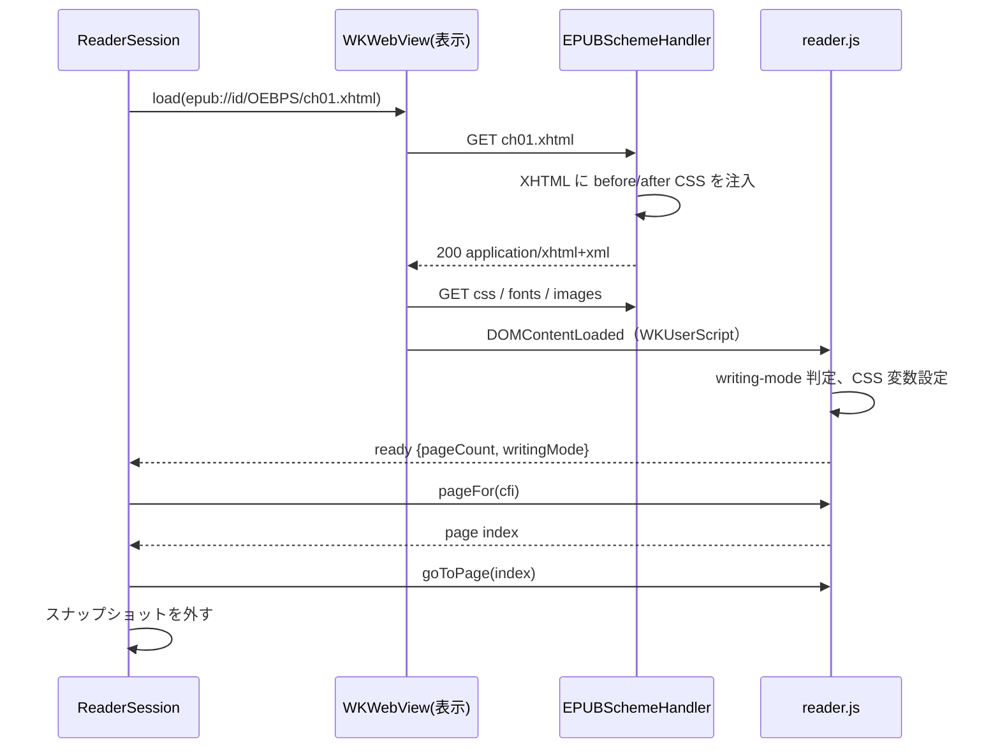

# 02. EPUBRenderer

WKWebView で spine item を描画し、ページ分割・位置・イベントを Swift 側に提供する層。
SwiftUI は import せず、UIKit / AppKit の WKWebView を扱う。

## 1. WebView の構成

表示用 WebView を 1 つ、事前ページ化用 WebView を 1 つ持つ。表示用は常に「現在の spine item」を 1 文書
読み込んでいる。ページめくりは文書内ではスクロール、章をまたぐときは次の文書の読み込みで行い、
いずれもスナップショット画像で演出する（§7）。

### 1.1 `WKWebViewConfiguration`

| 設定 | 値 | 理由 |
|---|---|---|
| `setURLSchemeHandler(_:forURLScheme: "epub")` | `EPUBSchemeHandler` | ZIP から直接配信 |
| `defaultWebpagePreferences.allowsContentJavaScript` | `false` | コンテンツ側 JS を止める。`WKUserScript` は動く |
| `userContentController` | `reader.js` を `.atDocumentEnd`、専用 `WKContentWorld` で登録 | 将来コンテンツ JS を許可しても分離される |
| `suppressesIncrementalRendering` | `true` | ページ化前の途中描画を見せない |
| `dataDetectorTypes`（iOS） | `[]` | 電話番号などの自動リンク化を止める |
| `allowsInlineMediaPlayback` | 既定のまま | 対象外機能なので触らない |
| `isInspectable` | DEBUG のみ `true` | Safari Web Inspector で確認する |

WebView 側:

- iOS: `scrollView.isScrollEnabled = false`、`bounces = false`、`contentInsetAdjustmentBehavior = .never`、
  `allowsLinkPreview = false`、`allowsBackForwardNavigationGestures = false`。
- macOS: `allowsBackForwardNavigationGestures = false`、`allowsMagnification = false`（FXL では `true`）。
- 背景色はテーマの背景色に合わせ、`isOpaque = false`（iOS）にして読み込み中の白フラッシュを避ける。

### 1.2 3 ページ幅のフレーム

表示用 WebView のフレームは可視領域の 3 ページ分（横書きなら幅 3 倍、縦書きなら高さ 3 倍）にし、
親ビューでクリップして中央の 1 ページだけを見せる。WebView は自分のフレーム全体を描画するので、
前後のページがスクロールなしに `takeSnapshot(with:)` の `rect` 指定で撮れる。
これでめくり開始時に次ページの画像を即座に用意でき、ドラッグ追従の演出が成り立つ。

章の境界では前後のページは別文書なので、事前ページ化用 WebView がその章を読み込んで先頭 / 末尾ページを撮る（§8.3）。

見開き時は「ページ」を「見開き 1 面」と読み替え、フレームは見開き 3 面分になる。

## 2. URL スキーム

### 2.1 URL 形式

```
epub://<publicationID>/<コンテナ内パス>
epub://<publicationID>/_reader/css/<name>.css
epub://<publicationID>/_reader/fonts/<name>
epub://<publicationID>/_reader/spread?left=<path>&right=<path>
```

- `publicationID` はライブラリが払い出した UUID（00-overview §5.3）。`EPUBSchemeHandler` は
  `PublicationRegistry` でこの ID から `EPUBContainer` を引く。
- `_reader/` 以下はライブラリが生成するリソース。コンテナ内に同名のパスがあっても `_reader/` を優先する。
- `Origin` が `epub://<publicationID>` になるので、同じ書籍のリソースは同一オリジンとして扱われ、
  iframe（§6）や `@font-face` が CORS に引っかからない。

### 2.2 `EPUBSchemeHandler`

`WKURLSchemeHandler` の実装。要求ごとに:

1. パスを解決し、`EPUBContainer.data(at:)` で読む（難読化解除込み）。
2. `Content-Type` は manifest の `media-type` を使い、なければ拡張子から推定する。
3. spine item の XHTML なら §3 の注入を行ってから返す。
4. 見つからなければ 404 相当の `URLResponse` を返し、`ReaderEvent.warning(.missingResource)` を出す。
5. `webView(_:stop:)` で停止要求された task には応答しない（応答すると WebKit が例外を投げる）。

読み出しは actor 側で行い、`urlSchemeTask.didReceive` は main actor で呼ぶ。

## 3. CSS 注入

### 3.1 レイヤー

Readium CSS の before / after の考え方を借り、自前の 2 ファイルを持つ。

| ファイル | 位置 | 役割 |
|---|---|---|
| `reader-before.css` | `<head>` の先頭 | ページ分割（多段組）、ページサイズの CSS 変数、既定の余白リセット、画像の最大サイズ、`ruby` の既定 |
| `reader-after.css` | `<head>` の末尾 | ユーザー設定（フォント、サイズ、行間、余白、テーマ色）と、`!important` で出版社 CSS を上書きする規則 |

出版社 CSS はその間に残る。before で土台を作り、after で読者の設定を勝たせる。

### 3.2 注入方法

`EPUBSchemeHandler` が XHTML のバイト列を文字列として読み、`<head>` の直後に before の `<link>` を、
`</head>` の直前に after の `<link>` を文字列挿入する。`<head>` がなければ `<html>` 直後に `<head>` ごと作る。
JS で後から挿入する方法はカスケード順と初回描画のちらつきで劣るので採らない。

同時に `<meta name="viewport">` が FXL 文書にない場合は警告する（FXL 仕様では必須）。

### 3.3 整形式でない XHTML

EPUBCore が `malformedXHTML` を記録した spine item は、`Content-Type: text/html` で配信する。
WebKit は XML 構文エラーを黄色いエラーページで表示するので、HTML パーサに切り替えて「可能な限り開く」。
この場合、WebKit の DOM は EPUBCore の libxml2 HTML パーサと同じ規則で構築されるため CFI が揃う。

### 3.4 ページ分割の CSS

横書き（`writing-mode: horizontal-tb`）:

```css
html {
  width: var(--reader-page-width);     /* 可視ページの幅。見開きなら 2 ページ分 */
  height: var(--reader-page-height);
  overflow: hidden;
  column-width: var(--reader-column-width);   /* 1 ページ分の幅 */
  column-gap: var(--reader-column-gap);
  column-fill: auto;
}
body { margin: 0; padding: var(--reader-margin-v) var(--reader-margin-h); }
```

縦書き（`writing-mode: vertical-rl`）:

```css
html {
  writing-mode: vertical-rl;
  width: var(--reader-page-width);
  height: var(--reader-page-height);
  overflow: hidden;
  column-width: var(--reader-page-height);  /* 縦書きでは column-width が縦方向のサイズになる */
  column-gap: 0;
  column-fill: auto;
}
```

縦書きの多段組は段がページの縦方向に積まれ、1 段 = 1 画面になる。ページ i は `scrollTop = i * pageHeight`。
横書きは `scrollLeft = i * pageWidth`。行は段の境界で分断されない。

`writing-mode` は強制しない。読み込み後に `getComputedStyle(document.documentElement).writingMode` を読み、
縦書きなら縦用の変数とスクロール軸に切り替える（`reader.js` が判定して Swift に報告する）。
出版社 CSS が `body` にだけ `writing-mode` を付けている場合は `html` に昇格させる。

縦書きの見開きは多段組では表現できない（段が縦に積まれるため 2 面を横に並べられない）。
縦書き + 見開きは §6 のラッパー文書で 2 つの iframe を並べて実現する。横書きの見開きは
`--reader-page-width` を 2 ページ分にして段を 2 本見せるだけでよい。

### 3.5 ユーザー設定の CSS 変数

| 変数 | 設定元 |
|---|---|
| `--reader-font-size` | `ReaderSettings.fontScale`。`html { font-size: calc(100% * var(--reader-font-size)) }` として出版社の `rem` / `em` 比率を保つ |
| `--reader-line-height` | `ReaderSettings.lineHeight`。`body` と段落に適用 |
| `--reader-margin-h` / `--reader-margin-v` | `ReaderSettings.pageMargins` |
| `--reader-fg` / `--reader-bg` / `--reader-link` | `ReaderSettings.theme` |
| `--reader-font-family` | `ReaderSettings.font`。`html[data-reader-font="override"] *` に `!important` で適用。`.publisher` のときは属性を付けない |

ナイトテーマでは `img, svg { filter: brightness(0.85) }` と `color-scheme: dark` を付ける。

### 3.6 フォント

- `.system(name)` は `font-family` に名前を書くだけ。
- `.custom(FontResource)` はアプリから受け取ったフォントファイルを `epub://<id>/_reader/fonts/<name>` で配信し、
  `reader-after.css` に `@font-face` を生成する。
- 出版社の `@font-face` は難読化解除済みで配信されるので WebKit がそのまま使う。

## 4. ブリッジ JS（`reader.js`）

ライブラリ同梱の 1 ファイル。専用 `WKContentWorld`（`reader`）で動き、`window.__epubReader` に API を置く。

### 4.1 Swift → JS

`callAsyncJavaScript(_:arguments:in:in:)` で呼び、戻り値を受け取る。

| 関数 | 役割 |
|---|---|
| `layout({pageWidth, pageHeight, columnsPerPage, margins})` | CSS 変数を更新し、`writing-mode` を判定して `{pageCount, writingMode}` を返す |
| `goToPage(index)` | スクロール位置を設定する |
| `pageFor(cfi)` | CFI を Range に解決し、`getBoundingClientRect` からページ番号を返す |
| `cfiForPage(index)` | そのページの先頭に見えるテキスト位置の CFI を返す（`caretRangeFromPoint` を使う） |
| `cfiForVisibleRange()` | 現在ページの先頭と末尾の CFI 範囲を返す |
| `setHighlights([{id, cfiRange, color, style}])` | CSS Custom Highlight API（`CSS.highlights`）で描画する。DOM を変更しない |
| `rectsFor(cfiRange)` | WebView 座標の矩形配列を返す（ハイライトのメニュー位置に使う） |
| `applySettings({...})` | CSS 変数とフォント上書き属性を更新する。必要なら `layout` を再実行する |
| `currentSelection()` | 選択中の `{cfiRange, text, rects}` を返す |
| `clearSelection()` | 選択を解除する |

### 4.2 JS → Swift

`WKScriptMessageHandlerWithReply` を `reader` という名前で登録する。メッセージは `{type, payload}` の JSON。

| type | payload | 発火 |
|---|---|---|
| `ready` | `{pageCount, writingMode}` | 文書の読み込みと初回 `layout` の完了 |
| `pageCountChanged` | `{pageCount}` | 画像読み込みやフォント読み込みで高さが変わったとき |
| `link` | `{href, isExternal}` | `a` のクリック（`preventDefault` 済み） |
| `noteref` | `{href, html, text}` | `a[epub\:type~="noteref"]` のクリック。同一文書内なら参照先要素の `innerHTML` と `textContent` を同梱する |
| `imageTap` | `{src, alt, rect}` | `img` または `svg image` のタップ |
| `selectionChanged` | `{cfiRange, text, rects}` または `null` | `selectionchange` |
| `tap` | `{x, y}` | リンクでも画像でもない場所のタップ。タップゾーン判定に使う |

`a` のクリックは常に `preventDefault` し、ナビゲーションは Swift が決める。
`WKNavigationDelegate.decidePolicyFor` でも初回読み込み以外は `.cancel` にして二重に防ぐ。

### 4.3 CFI の JS 実装

EPUBCore と同じ規則（01-core §5）で DOM を数える。WebKit の DOM には コメントノードが残るので
`nodeType` が ELEMENT / TEXT 以外は読み飛ばし、隣接テキストは結合して数える。
`Range` ↔ CFI の変換と、ID アサーションによる復元を実装する。

## 5. ページ分割とページ番号

### 5.1 章内のページ

`layout` の戻り値 `pageCount` は `ceil(scrollWidth / pageWidth)`（縦書きは `scrollHeight / pageHeight`）。
WebKit は多段組の総幅を `scrollWidth` で返す。最後の段が空になる端数は `column-fill: auto` で起きないが、
画像の遅延読み込みで増減するので `pageCountChanged` を監視する。

### 5.2 書籍全体のページ番号

`BookPagination` は spine 順に各章の `pageCount` を持ち、章 i のページ j を `offset(i) + j` と番号付けする。
値は 2 種類ある。

- 確定値: 事前ページ化（§8）で計測した章。
- 推定値: 未計測の章。`SpineItem.characterCount` と、計測済み章の「1 ページあたり文字数」の平均から推定する。
  計測済み章がなければ 1 ページ 600 文字（横書き）を初期値にする。

`BookPagination.isEstimated` が false になるのは全章の計測が終わったときだけ。UI は推定中であることを
表示できる。キャッシュのキーは `(publicationID, layoutKey)`。`layoutKey` はページサイズ、見開き有無、
`ReaderSettings` のレイアウトに影響する項目（フォント、サイズ、行間、余白）のハッシュ。テーマ色は含めない。

### 5.3 位置の復元

読書位置は常に CFI（表示ページ先頭の `cfiForPage`）で持つ。設定変更、リサイズ、章の再読み込みの後は
`pageFor(cfi)` で同じテキストが含まれるページに戻す。ページ番号は復元の手段には使わない。

## 6. FXL と見開き

### 6.1 ラッパー文書

FXL の spine item、および縦書き + 見開きのときは、ライブラリが生成する HTML
`epub://<id>/_reader/spread?left=...&right=...` を表示用 WebView に読み込む。
ラッパーは 1 つまたは 2 つの `iframe` を横に並べ、各 iframe に spine item を読み込む。
同一オリジンなので親文書の `reader.js` から iframe の DOM を触れる。

- FXL: 各 iframe は `<meta name="viewport">` の `width` / `height` の大きさで作り、
  CSS `transform: scale()` で可視領域に収める。見開きなら 2 面の合計を収める。
- 縦書き + 見開き: 同じ spine item を 2 つの iframe に読み込み、左右で隣接ページに `scrollTop` を合わせる。
  文書を 2 回レイアウトするのでメモリは 2 倍になる。選択は iframe をまたげない（制限として受け入れる）。

### 6.2 見開きの組み立て

`SpreadBuilder` が spine と `ReaderSettings`、可視領域の縦横比から「面の列」を作る。

- `rendition:spread` が `none` または可視領域が縦長なら単ページ。
- `page-spread-left` / `right` / `center` を尊重する。指定がなければ `page-progression-direction` から
  右綴じ（rtl）なら最初のページを左、左綴じなら右に置く。
- `center` は単独の面にする。
- リフロー + 横書きの見開きは多段組 2 本（§3.4）でラッパーを使わない。

### 6.3 ズーム

FXL のときだけ iOS の `scrollView.pinchGestureRecognizer` と macOS の `allowsMagnification` を有効にする。
ズーム中はページめくりジェスチャを無効にし、倍率が 1 に戻ったら再開する。

## 7. スナップショットとめくり演出

### 7.1 スナップショット

`WKWebView.takeSnapshot(with:)` に `rect` を指定して「現在ページ」「次ページ」「前ページ」の画像を撮る。
3 ページ幅のフレーム（§1.2）により、章内の前後ページはスクロールせずに撮れる。
`PageSnapshot` は `CGImage` とページ番号、CFI を持ち、現在の前後 1 ページずつだけ保持する。

### 7.2 めくりの手順

1. ジェスチャ開始または `goForward()` 呼び出しで、現在ページと移動先ページの `PageSnapshot` を用意する。
   移動先が別の章なら事前ページ化用 WebView から撮った画像を使い、なければ空白ページ（背景色）で代用する。
2. EPUBUI が 2 枚の画像で演出を描く。この間、表示用 WebView は画像の下に隠れている。
3. 演出の裏で表示用 WebView を移動先ページへスクロール、または別の章を読み込む。
4. `ready` を受け取り、現在ページの画像と一致したら画像を外して WebView を見せる。
   読み込みが演出より遅ければ、移動先の画像を表示したまま待つ。

これで WebView の読み込み待ちが演出と並行し、章をまたいでも空白が見えない。

### 7.3 VoiceOver

演出中の画像は `accessibilityElementsHidden = true` にし、読み上げ対象は常に WebView だけにする。
演出が終わって画像を外すまで VoiceOver のフォーカスを動かさない。

## 8. 事前ページ化

### 8.1 `PaginationService`（`@MainActor`）

非表示の WebView を 1 つ持ち、表示用と同じ `WKWebViewConfiguration`、同じフレームサイズ、同じ
`ReaderSettings` で spine item を順に読み込み、`layout` の `pageCount` を `PaginationCache` に書く。

順序: 表示中の章 → 次 → 前 → 先頭から順。ユーザーが章を移動したら優先順を組み替える。
1 章ごとに `await` を挟み、表示用 WebView の操作を優先する。

### 8.2 無効化

`layoutKey` が変わる（設定変更、リサイズ、見開き切り替え）たびに世代番号を上げ、古い世代の結果は捨てる。
進行中の読み込みはキャンセルする。キャッシュは `layoutKey` ごとに保持するので、設定を戻せば即座に確定値に戻る。

### 8.3 隣接章のスナップショット

次の章に移るめくりに備え、`PaginationService` は「次の章の先頭ページ」と「前の章の末尾ページ」を撮って
`PageSnapshot` として提供する。章のページ化と同じ読み込みで撮れるので追加コストは小さい。

### 8.4 メモリ

事前ページ化用 WebView は常時 1 つ。`UIApplication.didReceiveMemoryWarningNotification`（iOS）を受けたら
一時停止し、`PaginationCache` の他 `layoutKey` の項目を落とす。

## 9. 復旧

- `webViewWebContentProcessDidTerminate`: 現在の章を再読み込みし、保持している CFI に戻す。
  `ReaderEvent.error(.webContentTerminated)` を出す。
- リソース欠落: 404 を返して描画は続ける。警告イベントを出す。
- 読み込みタイムアウト（10 秒）: `ReaderEvent.error(.loadTimeout)` を出し、再試行はアプリに任せる。

## 10. 選択と編集メニュー

- iOS: `WKWebView` のサブクラスで `buildMenu(with:)` を上書きし、`SelectionAction` を `UIAction` として追加する。
  実行時に `currentSelection()` で `{cfiRange, text}` を取り、アプリのハンドラに渡す。
  「コピー」「調べる」「共有」はシステムのまま残す。
- macOS: `WKWebView` のサブクラスで `willOpenMenu(_:with:)` を上書きし、`NSMenuItem` を追加する。
- 既存ハイライトのタップは `reader.js` が `CSS.highlights` の範囲と当たり判定し、
  `ReaderEvent.highlightTapped(id, rects)` を出す。メニュー表示はアプリ側。

## 11. 章の読み込み手順（まとめ）


