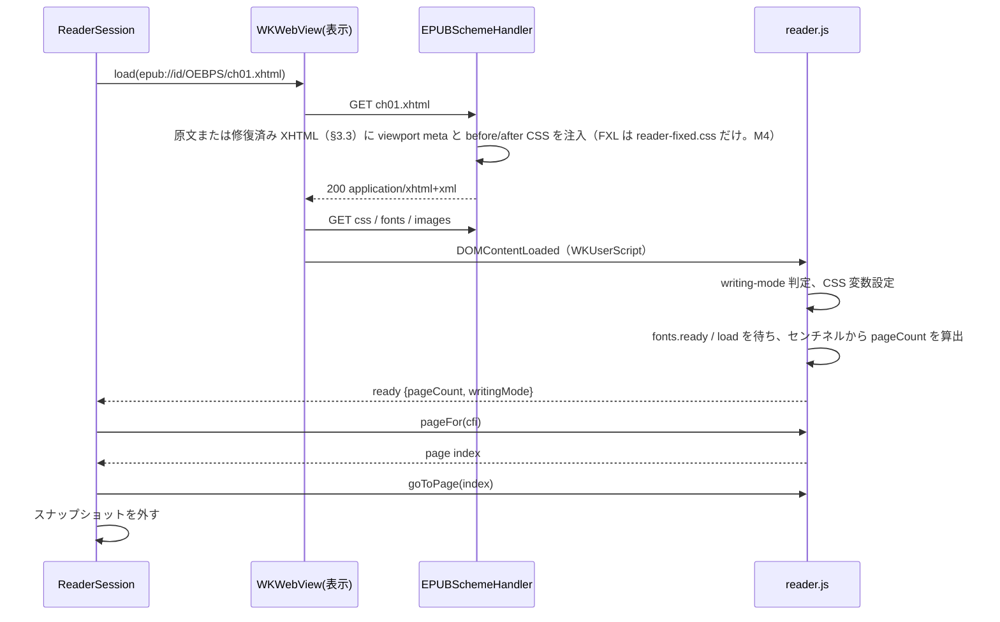

# 02. EPUBRenderer

WKWebView で spine item を描画し、ページ分割・位置・イベントを Swift 側に提供する層。
SwiftUI は import せず、UIKit / AppKit の WKWebView を扱う。

## 1. WebView の構成

表示用 WebView を 1 つ、事前ページ化用 WebView を 1 つ持つ。表示用は常に「現在の spine item」を 1 文書
読み込んでいる。ページめくりは文書内ではスクロール、章をまたぐときは次の文書の読み込みで行い、
いずれもスナップショット画像で演出する（§7）。

### 1.1 `WKWebViewConfiguration`

| 設定 | 値 | 理由 |
|---|---|---|
| `setURLSchemeHandler(_:forURLScheme: "epub")` | `EPUBSchemeHandler` | ZIP から直接配信 |
| `defaultWebpagePreferences.allowsContentJavaScript` | `false` | コンテンツ側 JS を止める。`WKUserScript` は動く |
| `userContentController` | `reader.js` を `.atDocumentEnd`、専用 `WKContentWorld` で登録 | 将来コンテンツ JS を許可しても分離される |
| `suppressesIncrementalRendering` | `true` | ページ化前の途中描画を見せない |
| `dataDetectorTypes`（iOS） | `[]` | 電話番号などの自動リンク化を止める |
| `allowsInlineMediaPlayback` | 既定のまま | 対象外機能なので触らない |
| `isInspectable` | DEBUG のみ `true` | Safari Web Inspector で確認する |

WebView 側:

- iOS: `scrollView.isScrollEnabled = false`、`bounces = false`、`contentInsetAdjustmentBehavior = .never`、
  `allowsLinkPreview = false`、`allowsBackForwardNavigationGestures = false`。
- macOS: `allowsBackForwardNavigationGestures = false`、`allowsMagnification = false`（FXL では `true`）。
- 背景色はテーマの背景色に合わせ、`isOpaque = false`（iOS）にして読み込み中の白フラッシュを避ける。

### 1.2 3 ページ幅のフレーム

表示用 WebView のフレームは可視領域の 3 ページ分（横書きなら幅 3 倍、縦書きなら高さ 3 倍）にし、
親ビューでクリップして中央の 1 ページだけを見せる。WebView は自分のフレーム全体を描画するので、
前後のページがスクロールなしに `takeSnapshot(with:)` の `rect` 指定で撮れる。
これでめくり開始時に次ページの画像を即座に用意でき、ドラッグ追従の演出が成り立つ。

章の境界では前後のページは別文書なので、事前ページ化用 WebView がその章を読み込んで先頭 / 末尾ページを撮る（§8.3）。

見開き時は「ページ」を「見開き 1 面」と読み替え、フレームは見開き 3 面分になる。

M4 で変更: 見開きラッパー文書（§6.1）はフレームのスロット 0 だけを使い、自分では横にスクロールしない（FXL の面は常に
1 ページ、縦書きラッパーは 2 つの iframe の `scrollTop` を動かす）。そのためラッパー表示中は章内の前後ページを隣のスロットから
撮れず、`pageSnapshot(.next / .previous)` は章内でも nil を返す（EPUBUI は到着後のページを撮って演出する。§7.2 の
destinationPending 経路）。横書きリフローの見開きは多段組 2 本の文書そのものなので、3 スロットがそのまま 3 面になる。

縦書きのフレームは高さを 3 ページ分にし、幅はページ幅に固定する（段は縦に積まれるため、幅を広げる理由がない）。

フレームが 3 ページ分あるため、文書の `scrollWidth`（縦書きは `scrollHeight`）はビューポート幅の 3 ページ分が下限になり、
2 ページ以下の章でもページ数を 3 と数えてしまう。ページ数は `scrollWidth` ではなく末尾センチネルの位置から求める（§5.1）。
先頭ページ表示時は WebView のオフセットを 0 にし、クリップの左 1 ページ分は空白（背景色）になる。
末尾ページでも同様で、スクロール位置は文書末尾でクランプされるため、センチネル位置から求めたページ数で
ページ i の `scrollLeft = i * pageWidth` を計算し、クランプには依存しない（05-spike-results §2.3）。

実装では WebView のフレームを 3 スロットに分け、`goToPage` が「可視スロット」（0〜2）を返す。
Swift はフレームの `origin.x` を `-visibleSlot * pageWidth` に置いてそのスロットをクリップ内に合わせる。
先頭ページはスロット 0、末尾ページはスロット 2、それ以外はスロット 1 に置くことで、文書の両端でも前後ページを撮れる範囲を最大にする。

iOS では、文書側の `scrollLeft` / `scrollTop` の設定を UI プロセスが非同期に `UIScrollView.contentOffset` へ反映し、
その際に古い `contentSize` でクランプすることがある（画像の遅延読み込みで文書が伸びている最中に連続でめくった場合）。
すると文書が報告するページと実際に見えている位置がずれる。`goToPage` は設定後の `scrollLeft` / `scrollTop` を戻り値に含め、
Swift 側は iOS で `scrollView.setContentOffset(_:animated: false)` を同じ値で呼んで同期する（M1 で発見。macOS には不要）。

## 2. URL スキーム

### 2.1 URL 形式

```
epub://<publicationID>/<コンテナ内パス>
epub://<publicationID>/_reader/css/<name>.css
epub://<publicationID>/_reader/fonts/<name>
epub://<publicationID>/_reader/spread?kind=<fixed|vertical>&pages=<spineIndex><l|r|f>[,<spineIndex><l|r|f>]
```

M4 で変更: ラッパーの引数はパスではなく spine index と配置（`l` 左半分 / `r` 右半分 / `f` 面全体）にした。
例: `?kind=fixed&pages=1r,2l`（右綴じの見開き。読み順で p02 が右、p03 が左）、`?kind=vertical&pages=5r,5l`
（縦書き章 5 を 2 フレームで）。`kind=fixed` は FXL、`kind=vertical` は縦書きリフローの見開き。`WebViewSpineRenderer.load`
が付ける `__reader_load` クエリは既存のクエリに追記する。

- `publicationID` はライブラリが払い出した UUID（00-overview §5.3）。`EPUBSchemeHandler` は
  `PublicationRegistry` でこの ID から `EPUBContainer` を引く。
- `_reader/` 以下はライブラリが生成するリソース。コンテナ内に同名のパスがあっても `_reader/` を優先する。
- `Origin` が `epub://<publicationID>` になるので、同じ書籍のリソースは同一オリジンとして扱われ、
  iframe（§6）や `@font-face` が CORS に引っかからない。

### 2.2 `EPUBSchemeHandler`

`WKURLSchemeHandler` の実装。要求ごとに:

1. パスを解決し、`EPUBContainer.data(at:)` で読む（難読化解除込み）。
2. `Content-Type` は manifest の `media-type` を使い、なければ拡張子から推定する。
3. spine item の XHTML なら §3 の注入を行ってから返す。
4. 見つからなければ 404 相当の `URLResponse` を返し、`ReaderEvent.warning(.missingResource)` を出す。
5. `webView(_:stop:)` で停止要求された task には応答しない（応答すると WebKit が例外を投げる）。

読み出しは actor 側で行い、`urlSchemeTask.didReceive` は main actor で呼ぶ。

## 3. CSS 注入

### 3.1 レイヤー

Readium CSS の before / after の考え方を借り、自前の 2 ファイルを持つ。

| ファイル | 位置 | 役割 |
|---|---|---|
| `reader-before.css` | `<head>` の先頭 | ページ分割（多段組）、ページサイズの CSS 変数、既定の余白リセット、画像の最大サイズ、`ruby` の既定 |
| `reader-after.css` | `<head>` の末尾 | ユーザー設定（フォント、サイズ、行間、余白、テーマ色）と、`!important` で出版社 CSS を上書きする規則 |

出版社 CSS はその間に残る。before で土台を作り、after で読者の設定を勝たせる。

2 つの CSS と `reader.js` は EPUBRenderer ターゲットの `Reader/` フォルダに `.copy` リソースとして同梱する。
フォルダ名を `Resources` にすると iOS の codesign がバンドル内の同名ディレクトリを拒否するため、この名前は使わない。

### 3.2 注入方法

`EPUBSchemeHandler` が XHTML のバイト列を文字列として読み、`<head>` の直後に before の `<link>` を、
`</head>` の直前に after の `<link>` を文字列挿入する。`<head>` がなければ `<html>` 直後に `<head>` ごと作る。
JS で後から挿入する方法はカスケード順と初回描画のちらつきで劣るので採らない。

同時に `<head>` へ `<meta name="viewport" content="width=device-width, initial-scale=1"/>` を注入する。
リフロー文書は通常この meta を持たず、iOS の WKWebView はそれがないとレイアウトビューポートを 980 px にして
多段組を縮小表示し、ページ境界が崩れる（05-spike-results §3）。文書が自前の viewport meta を持つ場合（FXL 文書）はそのまま通し、
FXL 文書に meta がなければ警告する（FXL 仕様では必須）。

M4 で変更: 注入の判断は書籍既定ではなく spine item ごとの `SpineItem.isFixedLayout` で行う（cole は本文がリフロー、
絵画のページだけ FXL）。FXL 文書には before / after CSS、viewport meta、設定の `<style>` のどれも注入せず、
`_reader/css/reader-fixed.css`（一時ハイライトの `::highlight()` 規則だけ）を `</head>` 直前に入れる。FXL のページは
出版社のデザインそのものなので、フォント・色・余白の上書きは当てない（ダークテーマの減光も当てない）。
viewport meta の有無の警告は Core が開いた時点で出す（01-core §7）。リフロー文書に注入する viewport meta には
`user-scalable=no` を付け、iOS の WKWebView がピンチで拡大しないようにする（ズームは FXL の面だけ。§6.3）。
見開きラッパー（§6.1）の viewport は FXL なら `maximum-scale=4`、縦書きリフローなら `user-scalable=no`。

### 3.3 整形式でない XHTML

WebKit は XML 構文エラーのある文書を `application/xhtml+xml` で受け取ると `parsererror` を立て、エラー箇所までしか描画しない。
EPUBCore が `malformedXHTML` を記録した spine item は、Core が libxml2 で回復して整形式に直列化した「修復済み XHTML」
（01-core §4.1）を、原文の代わりに `application/xhtml+xml` で配信する。WebKit は XML パーサで読むので DOM が Core の木と一致し、
CFI が揃う。CSS 注入（§3.2）は修復済み XHTML に対して行う。

Core が修復を諦めた文書（修復済み XHTML も XML として読めないもの）は、原文を `Content-Type: text/html` で配信して
「可能な限り開く」。この文書では WebKit の DOM と Core の木が一致しないため、`reader.js` は CFI の解決で
文字列アサーションを優先する（01-core §5.3）。検索結果やハイライトの位置が近傍にずれることは受け入れる。

`text/html` で WebKit に読ませて libxml2 の HTML パーサと DOM を揃える方式は採らない。
SDK の libxml2 は HTML5 の木構築規則を持たず、表や交差タグで要素インデックスがずれる（05-spike-results §2.5）。

### 3.4 ページ分割の CSS

横書き（`writing-mode: horizontal-tb`）:

```css
:root {
  --reader-column-width: calc(var(--reader-page-width) - 2 * var(--reader-margin-h));
  --reader-column-gap: calc(2 * var(--reader-margin-h));
}
html {
  box-sizing: content-box;
  width: var(--reader-column-width);                                  /* 内容幅 = ページ幅 - 左右余白 */
  height: calc(var(--reader-page-height) - 2 * var(--reader-margin-v));
  padding: var(--reader-margin-v) var(--reader-margin-h);             /* 余白は html の padding */
  overflow: hidden;
  column-width: var(--reader-column-width);
  column-gap: var(--reader-column-gap);                               /* 段間 = 左右余白 2 つ分 */
  column-fill: auto;
}
body { margin: 0; padding: 0; }
```

余白は `body` の padding ではなく `html` の padding と `column-gap = 2 × 左右余白` で作る。
`body` に padding を付けると最初の段にしか余白が付かず、2 段目以降のページは余白なしで始まる。
`html` の padding なら全段（全ページ）に同じ余白が付き、段の幅 + 段間 = ページ幅となってページ i の
`scrollLeft = i * pageWidth` がそのまま成り立つ（M1 で変更）。

縦書き（`writing-mode: vertical-rl`。M2 で変更）:

```css
:root { --reader-column-height: calc(var(--reader-page-height) - 2 * var(--reader-margin-v)); }
html[data-reader-writing-mode="vertical"] {
  /* width / height / padding は横書きと同じ。段の軸だけが変わる */
  column-width: var(--reader-column-height) !important;      /* 縦書きでは column-width が縦方向のサイズになる */
  column-gap: calc(2 * var(--reader-margin-v)) !important;   /* 段間 = 上下余白 2 つ分 */
}
```

縦書きでも余白は `html` の padding で作り、段の高さ + 段間 = ページ高さにして
ページ i の `scrollTop = i * pageHeight` を成り立たせる（横書きの `scrollLeft = i * pageWidth` と対称）。
`writing-mode` 自体は強制しない。段がページの縦方向に積まれ、1 段 = 1 画面になる。行は段の境界で分断されない。
ページ分割に関わる `html` の宣言はすべて `!important` にする（出版社 CSS が `html { width: 100% }` などを持つため）。

`writing-mode` は強制しない。読み込み後に `getComputedStyle(document.documentElement).writingMode` を読み、
縦書き（`vertical-*` / `sideways-*`）なら `html` に `data-reader-writing-mode="vertical"` を付けて上の CSS を効かせ、
スクロール軸を y に切り替える（`reader.js` が判定して `ready` と `layout` の `writingMode` で Swift に報告する。
Swift 側は `WritingMode` 列挙型で受ける）。出版社 CSS が `body` にだけ `writing-mode` を付けている場合は `html` に昇格させる。
Swift は縦書きの通知を受けるとフレームを 3 ページ分の高さに組み替える（§1.2）。

M5 で変更（スクロール範囲）: WebKit は横書き多段組のスクロール可能領域を最後の段の終わりで切り、`html` の末尾 padding を
含めない。そのため文書の幅が `pageCount` ページより余白 1 つ分短く、最後の数ページで `scrollLeft` が手前で止まってページが
余白分ずれて見えた。`reader-before.css` の `html::after`（`position: absolute`、`visibility: hidden`、DOM 外なので CFI・検索・
選択に影響しない）を `reader.js` の `applyExtent()` がページ数の確定ごとに `pageCount × ページ幅` の大きさにし、スクロール範囲を
ちょうどページ数分に広げる。縦書きでは同じ箱を `pageCount × ページ高さ` にする（縦書きでは症状は出ていないが対称にした）。
FXL では使わない。回帰テストは `PageAlignmentTests`（全ページの `scrollLeft` / `scrollTop` がページサイズの倍数か）。

M5 で変更（右から左の言語）: `<html dir="rtl">`（アラビア語など）では段が最初の段の左へ流れ、章全体が 1 ページと計測された。
`reader.js` は横書きで `direction: rtl` のルートに `data-reader-direction="rtl"` を付け、`reader-before.css` はルートを `ltr` で
組んで `body` に `rtl` を移す。文字の向きは変わらず、ページ i の `scrollLeft = i * pageWidth` がそのまま成り立つ。
ページを進める向き（左タップで次へ）は従来どおり `page-progression-direction` で決まる。

縦書きの見開きは多段組では表現できない（段が縦に積まれるため 2 面を横に並べられない）。
縦書き + 見開きは §6 のラッパー文書で 2 つの iframe を並べて実現する。横書きの見開きは
`--reader-page-width` を 2 ページ分にして段を 2 本見せるだけでよい。

### 3.5 ユーザー設定の CSS 変数

| 変数 | 設定元 |
|---|---|
| `--reader-font-size` | `ReaderSettings.fontScale`。`html { font-size: calc(100% * var(--reader-font-size)) }` として出版社の `rem` / `em` 比率を保つ |
| `--reader-line-height` | `ReaderSettings.lineHeight`。`body` と段落に適用 |
| `--reader-margin-h` / `--reader-margin-v` | `ReaderSettings.pageMargins` |
| `--reader-fg` / `--reader-bg` / `--reader-link` | `ReaderSettings.theme` |
| `--reader-font-family` | `ReaderSettings.font`。`html[data-reader-font="override"]` の `body` と、コード以外の子孫に `!important` で適用（§3.6）。`.publisher` のときは属性を付けない |

ナイトテーマでは `img, svg { filter: brightness(0.85) }` と `color-scheme: dark` を付ける。

### 3.6 フォント

- `.system(name)` は `font-family` に名前を書くだけ。名前は CSS の文字列として書く（`ContentInjector.cssString`）。
  文字列を終わらせる文字（`"`、`\`、改行などの制御文字）と、埋め込み先の文書で意味を持つ文字（`&`、`<`、`>`:
  XHTML の `<style>` の中身は XML として読まれる）は CSS のエスケープ（`\26 `）にする。名前は変わらず、XHTML 用と
  HTML 用（見開きのラッパー）で書き分ける必要も無い。
- `.systemUI` は OS の標準の本文フォント（San Francisco、和文はヒラギノ角ゴ）。ページから書けるファミリ名が無いので
  `-apple-system, system-ui, sans-serif` をそのまま渡す。どの上書きも、指定のフォントの後ろにこの並びを続ける。
- 上書きを掛けないもの: コード（`pre` / `code` / `kbd` / `samp` / `tt`）、数式（MathML の `math`）、図（`svg`）と、
  その中の要素。出版社のフォント（指定が無ければブラウザの既定: コードは `monospace`、数式は数式用フォント）のまま。
  コードは桁で揃えてあり、数式は数式用フォントの字形で組まれ、図の文字は組んだときのフォントの幅で置かれている。
  セレクタは `body *:not(:is(pre, code, kbd, samp, tt, math, svg), :is(…) *)` で、`reader-after.css` と、最初の描画の
  ための `ContentInjector.fontOverrideSelector` の 2 か所に同じものがある（`readerAfterStylesheetHasTheSameFontOverrideSelector`
  が 2 つの一致を、`fontOverrideLeavesCodeMathAndSVGInTheirOwnFont` が実際の計算値を確かめる）。
  - 外した要素が自分のフォントを持たず、親から継ぐ作りの本（`.listing { font-family: monospace } pre { font-family: inherit }`、
    `font-family` の無い SVG の `<text>`）では、親に掛かった上書きを継ぐ。上書き前の計算値を覚えて戻す仕組みは持たない
    （見送り。codex review of e5ac1d1）。
  - 出版社の CSS が ID や inline の `!important` でフォントを指定していると、上書きは負ける（前からの制限。同じ author
    origin の中の詳細度の勝負になる）。
- `.custom(FontResource)` はアプリから受け取ったフォントファイルを `epub://<id>/_reader/fonts/<name>` で配信し、
  `reader-after.css` に `@font-face` を生成する。
- 出版社の `@font-face` は難読化解除済みで配信されるので WebKit がそのまま使う。

## 4. ブリッジ JS（`reader.js`）

ライブラリ同梱の 1 ファイル。専用 `WKContentWorld`（`reader`）で動き、`window.__epubReader` に API を置く。

### 4.1 Swift → JS

`callAsyncJavaScript(_:arguments:in:in:)` で呼び、戻り値を受け取る。

| 関数 | 役割 |
|---|---|
| `layout({pageWidth, pageHeight, columnsPerPage, fixedLayout, margins, ...})` | CSS 変数を更新し、`writing-mode` を判定して `{pageCount, writingMode, columnsPerPage}` を返す。`writingMode` は CSS の値（`horizontal-tb` / `vertical-rl` / `vertical-lr`）。M4: `columnsPerPage`（1 / 2）は `--reader-columns` に入れる。縦書きでは常に 1 にして、実際の値を返す。`fixedLayout: true`（ラッパー内の FXL ページ）ならセンチネルも段組みも使わず `pageCount = 1` |
| `goToPage(index)` | ページ数を測り直してから index をクランプし、スクロール位置を設定する。`{pageIndex, slot, pageCount, scrollLeft, scrollTop}` を返す（§1.2 のスロットと iOS の同期に使う） |
| `pageForFragment(id)` | 文書内リンクと目次の `#fragment` が指す要素のページを返す |
| `pageFor(cfi)` | CFI（点、または範囲の始点）を Range に解決し、その文字（要素なら要素）の矩形からページ番号を返す。解決できなければ null |
| `cfiForPage(index, margins)` | そのページの先頭に見えるテキスト位置の CFI を返す。3 スロットのフレーム内のページは `caretRangeFromPoint` を余白の内側から何点か試す。フレーム外のページ（`caretRangeFromPoint` が効かない）はテキストノードの矩形を走査し、ページ境界をまたぐノードは文字の矩形を二分探索して先頭文字を決める。テキストがなければ 1 ページに収まる要素、それもなければ葉要素（ページより大きい画像など）の CFI。何もなければ null（M3） |
| `setHighlights([{id, cfiRange, color, style}])` | CSS Custom Highlight API（`CSS.highlights`、キー `reader-h-<id>`）で描画する。`style` は `solid` / `underline` / `strikethrough` / `outline`（M6 で変更。旧 `background` / `underline`）。`outline` 以外は `<style id="__reader_highlights">` に `::highlight()` 規則を書く。`outline` は重ね描きレイヤー `<div id="__reader_overlay">`（`<html>` の最後の子）に枠として描く（06-annotations §10.3）。配列の後ろほど上に描き（`Highlight.priority`）、タップの判定も後ろを優先する。解決できた id の配列を返す |
| `setTransientHighlight(cfiRange)` | 検索結果用の一時ハイライト 1 つ（キー `reader-transient`、`reader-before.css` でスタイル）。null で消す（M3） |
| `rectsFor(cfiRange)` | WebView（3 スロットのフレーム）座標の矩形配列を返す。Swift 側がスロットのオフセットを引いて可視ページ座標にする |
| `applySettings({...})` | CSS 変数とフォント上書き属性を更新する。必要なら `layout` を再実行する |
| `currentSelection()` | 選択中の `{cfiRange, text, rects}` を返す |
| `clearSelection()` | 選択を解除する |

`layout` は `spineSteps`（`/6/4[chap01]` の形）も受け取り、生成する CFI の先頭に付ける。

M6 で追加: 重ね描きレイヤーの枠は `Range` を追わないので、`layout`・`applySettings`・遅延画像やフォントによる再計測
（`pageCountChanged` の判定）のたびに `reader.js` が描き直す。outline が 1 つも無ければレイヤー要素ごと取り除く。
レイヤーは `pointer-events: none`・`aria-hidden` で、`<body>` の後ろにあるので CFI のステップとページ数に影響しない
（06-annotations §12.3）。`cfiForPage` の予備の要素選びはレイヤー内の要素を飛ばす。Swift 側の id は層ごとに `a:`（アプリ）/
`p:`（同梱注釈）を前に付けたもので、`highlightTap` を受けたら外して `annotationTapped` にする。
M3 で変更: `captureAnchor` / `pageForAnchor`（M1〜M2 の DOM アンカー）は削除した。`cfiForVisibleRange()` は
使い道がまだないので実装していない。

M4 で追加: `reader.js` は `forMainFrameOnly: false` で登録し、見開きラッパー（§6.1）の iframe の中でも動く。
iframe 内の文書（`window.top !== window`）は Swift にメッセージを送らず、`setHost(fn)`（イベントの送り先）と
`whenReady()`（`load` と `fonts.ready` 後に `{writingMode}` で解決）を公開する。ラッパー文書（`html[data-reader-spread]`）では
同じスクリプトが「見開きコントローラ」になり、上の表と同じ API を Swift に見せる: 各 iframe の `load` → `whenReady()` を待って
`ready` を送り、`layout` で iframe を配置・スケールしてから各 iframe の `layout` を呼び、`pageFor` / `rectsFor` /
`setHighlights` / `setTransientHighlight` は CFI の spine ステップで iframe を選んで転送（id があれば id、なければ index で照合）、
`cfiForPage` は読み順で最初の iframe から順に聞く。iframe から受けた `tap` / `highlightTap` / `selectionChanged` の座標は
`iframe の位置 + 座標 × scale` でラッパー座標に直す（縦書きラッパーでは iframe の枠でクリップする）。親の reader ワールドから
`iframe.contentWindow.__epubReader` が見えること（WebKit の content world はフレームをまたいで同じワールドの
グローバルを共有する）は M4 の最初にスパイクで確認した。テスト用に `frameInfo()`（各 iframe の位置・大きさ・scale）を持つ。

### 4.2 JS → Swift

`WKScriptMessageHandlerWithReply` を `reader` という名前で登録する。メッセージは `{type, payload}` の JSON。

| type | payload | 発火 |
|---|---|---|
| `ready` | `{writingMode, readyState, href}` | 文書の読み込み完了（`layout` は Swift が続けて呼ぶ）。`href` は文書の `location.href`。Swift は `load` ごとに URL へ一意なクエリ `__reader_load=<n>` を付けるので、同じ章を続けて読み込んだときも、置き換えられた古い文書の `ready` を取り違えずに捨てられる（M2 で変更。フラグメントでは同一文書ナビゲーションになり `reader.js` が再実行されないのでクエリを使う。スキームハンドラは `url.path` で解決するためクエリは無視される）。`.atDocumentEnd` の `WKUserScript` は `DOMContentLoaded` 相当（`readyState = "interactive"`）で動き、画像とフォントはまだ読み込まれていない。`reader.js` は `document.fonts.ready` と `load` を待ってから初回 `layout` を確定し `ready` を送る。それ以降の増減は `pageCountChanged` で補正する |
| `pageCountChanged` | `{pageCount}` | 画像読み込みやフォント読み込みで高さが変わったとき |
| `link` | `{href, isExternal}` | `a` のクリック（`preventDefault` 済み） |
| `noteref` | `{href, rect, sameDocument, html?, text?, cfi?, hidden?}` | `a[epub\:type~="noteref"]` のクリック。同一文書内なら参照先要素の `innerHTML`・テキスト・CFI を同梱する（M5 で変更） |
| `imageTap` | `{src, alt, rect, x, y}` | `img` または `svg image` のタップ（リンク内と FXL のページを除く。M5 で変更） |
| `selectionChanged` | `{selection: {cfiRange, text, rects} \| null}` | `selectionchange`（120 ms デバウンス）。空白だけの選択は null |
| `highlightTap` | `{id, rects}` | `setHighlights` で描いた範囲へのクリック。リンク → ハイライト → `tap` の順で判定する（M3）。重なっていれば上に描いたもの（M6） |
| `tap` | `{x, y}` | リンクでもハイライトでもない場所のタップ。タップゾーン判定に使う |

`a` のクリックは常に `preventDefault` し、ナビゲーションは Swift が決める。
`WKNavigationDelegate.decidePolicyFor` でも初回読み込み以外は `.cancel` にして二重に防ぐ。

M5 で変更（`link` / `noteref` / `imageTap` の実際の形）:

- `link` は `{href, isExternal}`。Swift の `LinkDestination.resolve` が外部 URL・spine item（+ フラグメント）・spine 外の資源・
  欠落・無視（他の出版物の `epub://`）に分ける。spine item へのリンクは移動して `ReaderEvent.internalLink(CFI)` を出し、
  CFI はフラグメントの要素（EPUBCore の `CFIGenerator.cfi(forElementWithID:)`）か、なければ文書先頭。外部 URL は
  `externalLink` を出すだけで移動しない。spine 外の資源（画像への直接リンクなど）は無視し、欠落は `missingResource` 警告。M1 の `handleLink` にあった二重のパーセントデコードはやめた。
- `noteref` は `epub:type~="noteref"` のリンクだけ（`role="doc-noteref"` だけのリンクや脚注番号風の普通のリンクは `link` 扱い）。
  payload は `{href, rect, sameDocument, html?, text?, cfi?, hidden?}`。同じ文書の脚注は参照先要素（`aside` / `li` などを
  `noteElement` で上にたどった要素）の `innerHTML`、空白を詰めた `textContent`、要素の CFI、ページ上に組まれていないか
  （`hidden`: 要素にもその中身にも `getClientRects()` が無い = 下の隠した `aside` と出版物の CSS の `display: none`、
  または `visibility` が `hidden` / `collapse`）を同梱する。別文書の脚注は Swift が
  EPUBCore で文書を読み、`XMLDocument.notePath(forElementWithID:)` で要素を見つけてテキストと CFI を作る（`html` は nil）。
- `imageTap` は `{src, alt, rect, x, y}`。`img` と SVG の `image`（`alt` は `aria-label` / `<title>`）。リンク内の画像はリンク扱い。
  FXL のページでは送らない（絵がページそのものなので、タップはめくりに使う）。
- 同じ文書内の noteref が指す `aside[epub:type~="footnote" | "endnote" | "rearnote"]` は本文の流れから外す
  （`data-reader-note="hidden"`、`reader-before.css` で `display: none`）。何からも参照されない脚注は表示したまま。
  `hidden` 属性は出版社 CSS より優先させる。
- ラッパー文書（§6.1）は iframe から受けた `rect` と `x` / `y` を面の座標に直して送る。

M4 で変更: iframe 内の文書はこれらのメッセージを Swift に送らない（ホストに渡し、ラッパーが座標を直して送る。
ホストがない iframe、つまり本文中の iframe はどこにも送らない）。ラッパーの `ready` は全 iframe の準備が終わってから、
`writingMode` は縦書きラッパーなら中の文書の値、FXL なら `horizontal-tb`。縦書きラッパーの `pageCountChanged` は
中の文書のページ数を 2 で割って切り上げた面数で送る。

### 4.3 CFI の JS 実装

EPUBCore と同じ規則（01-core §5）で DOM を数える。WebKit の DOM には コメントノードが残るので
`nodeType` が ELEMENT / TEXT / CDATA 以外は読み飛ばし、隣接テキスト（コメントで分断されたものを含む）は
結合して 1 つの論理テキストノードとして数える。オフセットは UTF-16 コードユニット（DOM の単位そのまま）。
`Range` ↔ CFI の変換、ID アサーションによる復元、テキストアサーションの照合と本文検索による再解決を実装する。
テスト用に `describe` / `canonical` / `rangeParts` を公開し、`CFIScriptTests` が EPUBCore と同じ
`cfi-vectors.json` を実 WKWebView で流す（M3）。

## 5. ページ分割とページ番号

### 5.1 章内のページ

`layout` は `body` の末尾に空のセンチネル要素（`<span id="__reader_end"></span>`、`display: inline-block; width: 0; height: 0`）を置き、
その `getBoundingClientRect()` と現在のスクロール位置から文書末尾の座標を求め、
`pageCount = floor(endX / pageWidth) + 1`（縦書きは `endY / pageHeight`）とする。

`scrollWidth` は使わない。3 ページ幅のフレーム（§1.2）ではビューポート幅が下限になり、2 ページ以下の章で 3 を返す
（05-spike-results §2.3）。縦書きの `scrollHeight` は 3 ページ高フレームでもページ高の整数倍になるが、同じ理由で短い章では
下限に張り付くので、横書きと同じくセンチネルで統一する。

最後の段が空になる端数は `column-fill: auto` で起きないが、画像の遅延読み込みで増減するので `pageCountChanged` を監視する。

Swift 側が持つ `chapterPageCount` は、この通知の到着前は古い値になりうる。そのため `goForward()` は
「現在ページが既知のページ数の最後だから次章へ」とは判断せず、まず文書に `goToPage(current + 1)` を要求する。
`goToPage` はその場でページ数を測り直してからクランプするので、ページが増えていれば章内で進み、
動けなかった（戻り値の `pageIndex` が変わらない）ときだけ次の線形 spine item を読み込む（M1 で変更）。

### 5.2 書籍全体のページ番号

`BookPagination` は spine 順に各章の `pageCount` を持ち、章 i のページ j を `offset(i) + j` と番号付けする。
値は 2 種類ある。

- 確定値: 事前ページ化（§8）で計測した章、または表示用 WebView 自身が表示した章（表示側の計測もキャッシュに書く）。
- 推定値: 未計測の章。`SpineItem.characterCount` と、計測済み章の「1 ページあたり文字数」から推定する。
  計測済み章がなければ 1 ページ 600 文字（横書き）/ 500 文字（縦書き）を初期値にする。

M2 で決めた推定の規則: 比率を学習するのは 500 文字以上の計測済み章だけ（表紙や扉のような「画像と数語で 1〜2 ページ」
の章が比率を下げ、全章の推定を数倍に膨らませるため）。比率は 50〜10000 文字/ページにクランプする。
非線形（`linear="no"`）の spine item は番号付けに含めない。

`BookPagination.isEstimated` が false になるのは全章の計測が終わったときだけ。UI は推定中であることを
表示できる（`estimatedChapterCount`）。キャッシュのキーは `(publicationID, layoutKey)`。`layoutKey` は
整数に丸めたページサイズ、見開き有無、`ReaderSettings.layoutKey`（フォント、サイズ、行間、余白）。テーマ色は含めない。
`ReaderSession.totalProgression` は `BookPagination` のページ番号から求める（確定前は推定値ベース）。

M4 で変更: 見開き有無は `LayoutKey.isSpread`（`SpreadPlan.hasTwoPageReflow`。リフロー章を 2 ページの面で見せるか）として
入れた。ページサイズと `spreadPolicy` から決まる値だが、キーに明示する。見開きのときは 1 面に 2 ページ分の文字が
入るので、推定の初期値（600 / 500 文字）を 2 倍にする。FXL のページは 1 spine item = 1 ページで数える（見開きの 2 ページは
書籍ページ 2 つ。`currentPage` は面の先頭ページ）。見開き面の計測値は面の全メンバーに書く。

### 5.3 位置の復元

読書位置は常に CFI（表示ページ先頭の `cfiForPage`）で持つ。設定変更、リサイズ、章の再読み込みの後は
`pageFor(cfi)` で同じテキストが含まれるページに戻す。ページ番号は復元の手段には使わない。

M3 実装済み: `ReaderSession` は章の読み込み、ページ移動、設定変更、`pageCountChanged` のたびに `cfiForPage` を呼び、
`position: ReadingPosition`（CFI、spine index、目次の章名、章内・全体の進捗）を更新して
`ReaderEvent.positionChanged` を出す。再レイアウトは `applySettings` の前に `cfiForPage(currentPageIndex)` を取り、
後に `pageFor` で戻す（解決できなければ章内の進捗率で近似）。WebContent プロセスの終了後の再読み込みも
`position.cfi` で戻す。テキストのないページ（画像だけの表紙）は要素の CFI、それもなければ章の `body` の CFI を
位置にするので、章を表示した後は `position` が nil になることはない。M1〜M2 の DOM アンカーは削除した。

再レイアウト中の見た目（M2）: `ReaderSession` は再レイアウトの前に可視ページのスナップショットを撮って
`relayoutSnapshot` に置き、位置を復元し終えたら nil に戻す。表示用 WebView のページサイズ変更も再レイアウトの
操作の中で行うので、中間サイズで流し込まれた文書が画面に出ることはない。EPUBUI はこの画像を WebView の上に重ね、
nil になったらクロスフェードで外す（03-api §4.5）。

## 6. FXL と見開き

### 6.1 ラッパー文書

FXL の spine item、および縦書き + 見開きのときは、ライブラリが生成する HTML
`epub://<id>/_reader/spread?left=...&right=...` を表示用 WebView に読み込む。
ラッパーは 1 つまたは 2 つの `iframe` を横に並べ、各 iframe に spine item を読み込む。
同一オリジンなので親文書の `reader.js` から iframe の DOM を触れる。

- FXL: 各 iframe は `<meta name="viewport">` の `width` / `height` の大きさで作り、
  CSS `transform: scale()` で可視領域に収める。見開きなら 2 面の合計を収める。
- 縦書き + 見開き: 同じ spine item を 2 つの iframe に読み込み、左右で隣接ページに `scrollTop` を合わせる。
  文書を 2 回レイアウトするのでメモリは 2 倍になる。選択は iframe をまたげない（制限として受け入れる）。

M4 で変更・確定した点:

- ラッパーは `SpreadDocument`（EPUBRenderer）が生成する。`<html data-reader-spread="fixed|vertical" data-reader-progression="ltr|rtl">`
  の下に `#__reader_stage` と iframe（`data-order` / `data-spine-index` / `data-spine-steps` / `data-width` / `data-height` /
  `data-placement`、`scrolling="no"`）を置く。iframe は配置が終わるまで `visibility: hidden`。ラッパー自身は `text/html` で配信し、
  viewport meta を持つ。`reader.js` は iframe の中でも動くので、中の文書も通常どおり注入済みの XHTML を読む（§3.2）。
- FXL の面: 各 iframe を `viewport` の大きさ（`data-width` / `data-height`。viewport がない文書は可視領域の大きさ）で作り、
  面の幅（単独なら全幅、ペアなら半分ずつ）と高さに収まる `scale` を取る。ペアは 2 ページで同じ scale を使い、全体を中央に置く。
  左右どちらかだけの面（`l` / `r`）は中央線に接して置き、`f`（全面）は面の中央に置く。
- 縦書きの面 k は中の文書のページ 2k（右）と 2k+1（左）を 2 つの iframe（各 W/2 × H）で見せ、面数は ceil(ページ数 / 2)。
  最後の面が 1 ページなら 2 つ目の iframe を隠す。`vertical-rl` では最初のページが右、`vertical-lr` では左。
- ラッパーはスロット 0 だけを使い、前後の面を隣のスロットには置かない（§1.2）。

### 6.2 見開きの組み立て

`SpreadBuilder` が spine と `ReaderSettings`、可視領域の縦横比から「面の列」を作る。

- `rendition:spread` が `none` または可視領域が縦長なら単ページ。
- `page-spread-left` / `right` / `center` を尊重する。指定がなければ `page-progression-direction` から
  右綴じ（rtl）なら最初のページを左、左綴じなら右に置く。
- `center` は単独の面にする。
- リフロー + 横書きの見開きは多段組 2 本（§3.4）でラッパーを使わない。

M4 で変更・確定した点（`SpreadBuilder.plan(for:policy:viewportSize:)` → `SpreadPlan`）:

- `SpreadPlan.Unit` は `.reflowable(spineIndex:twoPages:)` か `.fixed(pages: [FixedPage])`（`FixedPage` は spine index と
  `placement: left / right / full`）。`ReaderSession.currentUnit` が今表示している面で、`visibleSpineIndices` / `isShowingSpread` は
  そこから出す。
- 見開きにするかは `ReaderSettings.spreadPolicy`（`auto` = 横長なら見開き、`never`、`always`）と書籍の `rendition:spread`
  （`none` なら常に単ページ。`landscape` / `both` / `auto` は `auto` 扱い）で決める。itemref の `rendition:spread-*` 上書きも読む。
  `rendition:orientation` は読むが、端末の向きの固定は行わない。
- 単ページのとき FXL は `full` で 1 ページずつ、リフローは `twoPages = false`。
- 見開きのとき: `page-spread-*` の指定どおりに置き、連続する FXL の線形 item で左右が噛み合えば 1 面にする。指定がない FXL
  ページは「前の面の反対側」から始めて交互に置く（右綴じなら最初は右、左綴じなら左。これは「最初のページを左 / 右」の
  上の記述を改めたもの。表紙や最初のページは綴じ側の反対に置くのが一般的なため）。`center` と `linear="no"` は単独の面。
  リフロー item は `twoPages = true` で 1 面（横書きなら 2 段、縦書きならラッパー）。
- 面をまたぐ判定（`unit(containing:)`、`isShowing(spineIndex:)`）で、見開きの右ページへの `go(toSpineIndex:)` / CFI 移動は
  読み込み直しをしない。リサイズで単ページ ⇄ 見開きが変わるときは現在の CFI（`position`）の spine item を含む面を読み直す。

M5 で変更: 右綴じ（`page-progression-direction="rtl"`）の本の横書きリフローの見開きも、縦書きと同じ 2 フレームのラッパー
（最初のページが右）で表示する。多段組 2 本では段が左から埋まり、右綴じの読み順と逆になるため。判定は
`ReaderSession.spreadNeedsWrapper(writingMode:publication:)`（縦書き、または `pageProgression == .rtl`）で、
`PaginationService` の読み直し判定も同じ関数を使う。

### 6.3 ズーム

FXL のときだけ iOS の `scrollView.pinchGestureRecognizer` と macOS の `allowsMagnification` を有効にする。
ズーム中はページめくりジェスチャを無効にし、倍率が 1 に戻ったら再開する。

M4 で確定した点: `SpineRenderer` に `setZoomEnabled(_:)` / `resetZoom()` / `onZoomChanged` を足し、`ReaderSession` は面を
読み込むたびに `setZoomEnabled(unit.isFixedLayout)` と `resetZoom()` を呼ぶ。倍率が 1.01 を超えたら `isZoomed = true` で
`ReaderEvent.zoomChanged(true)` を送り、EPUBUI はスワイプ・トラックパッド・タップめくりを止める（`resetZoom()` で戻せる）。
iOS では WebKit が viewport meta から scroll view の倍率範囲を決め直すので、`maximumZoomScale` を Swift から設定するのではなく
viewport meta で制御する（§3.2。FXL ラッパーは `maximum-scale=4`、それ以外は `user-scalable=no`）。WKWebView の scroll view は
ピンチ中に `zoomScale` の KVO を出さず、`pinchGestureRecognizer` も拡大可能になるまで nil なので、各文書の読み込み完了
（`didFinish`）と許可の切り替えのたびに認識器を取り直してターゲットを足し、`isEnabled` を合わせる（iOS 27 Simulator で確認）。
ズーム中だけ `scrollView.isScrollEnabled = true` にしてパンできるようにする。
macOS は `ReaderWebView` が `magnification` / `setMagnification(_:centeredAt:)` / `magnify(with:)` / `smartMagnify(with:)` を
上書きして `onMagnificationChanged` を出す。ズームはラッパー文書全体に掛かる（3 スロット幅のフレームごと動く。
FXL の面はスロット 0 だけなので実害はないが、パンの範囲は面より広い。`TODO.md` 参照）。

## 7. スナップショットとめくり演出

### 7.1 スナップショット

`WKWebView.takeSnapshot(with:)` に `rect` を指定して「現在ページ」「次ページ」「前ページ」の画像を撮る。
3 ページ幅のフレーム（§1.2）により、章内の前後ページはスクロールせずに撮れる（macOS 約 0.4 ms、iOS 約 8 ms。05-spike-results §2.3）。
`PageSnapshot` は `CGImage`、`scale`、`size`（pt）、`spineIndex`、`pageIndex` を持つ（CFI は M3 で追加）。
表示用 WebView からは必要なときに撮り、保持するのは事前ページ化側の隣接章の先頭 / 末尾ページだけ（§8.3）。
`WKSnapshotConfiguration.rect` と `snapshotWidth` は pt で指定し、返る画像はバッキングスケール倍のピクセルになるので、
`scale` を持たせて EPUBUI が pt で描けるようにする。

iOS の `takeSnapshot` は画面に合成された見た目を撮る（macOS は WebContent プロセスの描画結果を返す）。
そのため iOS では、演出用の画像や他のビューを WebView に重ねる前に撮り、WebView はセーフエリア内に置いて
ステータスバーと重ねない。ウィンドウの出現アニメーション中に撮るとぼやけるので、初回のスナップショットは
アニメーション完了後に撮る（05-spike-results §3）。

### 7.2 めくりの手順

1. ジェスチャ開始または `goForward()` 呼び出しで、現在ページと移動先ページの `PageSnapshot` を用意する。
   移動先が別の章なら事前ページ化用 WebView から撮った画像を使い、なければ空白ページ（背景色）で代用する。
2. EPUBUI が 2 枚の画像で演出を描く。この間、表示用 WebView は画像の下に隠れている。
3. 演出の裏で表示用 WebView を移動先ページへスクロール、または別の章を読み込む。
4. `ready` を受け取り、現在ページの画像と一致したら画像を外して WebView を見せる。
   読み込みが演出より遅ければ、移動先の画像を表示したまま待つ。

これで WebView の読み込み待ちが演出と並行し、章をまたいでも空白が見えない。

### 7.3 VoiceOver

演出中の画像は `accessibilityElementsHidden = true` にし、読み上げ対象は常に WebView だけにする。
演出が終わって画像を外すまで VoiceOver のフォーカスを動かさない。

M5 で変更: 章の読み込み中に WebView を `isHidden` にするとアクセシビリティツリーから外れ、VoiceOver のフォーカスが飛んでいた。
代わりに背景色の「幕」（`curtain`。アクセシビリティ要素ではない）を WebView の上に被せ、WebView は常にツリーに残す。
iOS ではホストビューが `accessibilityScroll`（VoiceOver の 3 本指スワイプ）にページ送りで応え、ページの進む向きに従い、
「Page n of m」を `.pageScrolled` で読み上げる。実機・シミュレータでの VoiceOver の通し確認は未実施（`TODO.md`）。

## 8. 事前ページ化

### 8.1 `PaginationService`（`@MainActor`）

非表示の WebView（2 つ目の `WebViewSpineRenderer`。同じスキームハンドラ、同じフレームサイズ、同じ `ReaderSettings`）を
1 つ持ち、線形の spine item を順に読み込み、`layout` → `goToPage(0)` の `pageCount` を `PaginationCache` に書く。
どのウィンドウにも載せないままで読み込み・レイアウト・`takeSnapshot` が動く（macOS、iOS 27 Simulator で確認。M2）。

順序: 次 → 前 → 先頭から順（表示中の章は表示用 WebView が計測する）。ユーザーが章を移動したら
`setCurrentSpineIndex` で優先順を組み替える。このとき進行中の章はキャンセルせず最後まで計測する
（キャンセルして同じ章を読み直すと、古い文書の `ready` が新しい読み込みに答えてしまう）。
1 章ごとに `await` を挟み、表示用 WebView の操作を優先する。1 章の読み込みは `ready` 10 秒、全体 20 秒で打ち切り、
失敗した章はそのレイアウトでは再試行しない（`onChapterFailed`）。`kusamakura` 全 15 章で約 0.7 秒（macOS）。

### 8.2 無効化

`layoutKey` が変わる（設定変更、リサイズ、見開き切り替え）たびに `PaginationCache.select` が世代番号を上げ、
古い世代の結果は `store` が捨てる。M4 で変更: `configure` は `SpreadPlan` も受け取り、面（`Unit`）単位で読み込む。FXL の面は
ラッパー URL を読み、メンバーの各 spine item に 1 ページずつ書く。縦書きリフローはまず単文書で読み、`writingMode` が縦書きで
見開きの面なら縦書きラッパーで読み直す（`lastWritingMode` を次回のヒントにする）。進行中の読み込みは `configure` でキャンセルし、隣接章のスナップショットも
捨てる（別レイアウトの画像だから）。キャッシュは `layoutKey` ごとに保持するので、設定を戻せば即座に確定値に戻る。
ページサイズは整数 pt に丸めてキーにする（SwiftUI のレイアウトの端数で世代が変わらないように）。

### 8.3 隣接章のスナップショット

次の章に移るめくりに備え、`PaginationService` は「次の章の先頭ページ」と「前の章の末尾ページ」を撮って
`PageSnapshot` として提供する。章のページ化と同じ読み込みで撮れるので追加コストは小さい。
`ReaderSession.pageSnapshot(.next)` は章末で、`.previous` は章頭でこの画像を返す（未取得なら nil で、EPUBUI は背景色で代用する）。
隣接章が変わると古い隣接章の画像は捨て、未撮影の隣接章は計測済みでも読み込み直して撮る（M2 実装済み）。

### 8.4 メモリ

事前ページ化用 WebView は常時 1 つ。`UIApplication.didReceiveMemoryWarningNotification`（iOS）を受けたら
`pause()` で一時停止してスナップショットを捨て、`PaginationCache.dropOtherLayouts()` で他 `layoutKey` の項目を落とす。
次の章移動（`setCurrentSpineIndex`）か `resume()` で再開する（M2 実装済み）。

M5 で変更: 設定変更やリサイズによる `configure`（新しいレイアウトでの計測）でも一時停止を解く（M2 の Codex レビューの指摘）。
メモリ警告では `ReaderSession` が持つ検索インデックス（`SearchService` の抽出結果）も捨て、次の検索で作り直す。

## 9. 復旧

- `webViewWebContentProcessDidTerminate`: 現在の章を再読み込みし、保持している CFI に戻す。
  `ReaderEvent.error(.webContentTerminated)` を出す。
- リソース欠落: 404 を返して描画は続ける。警告イベントを出す。
- 読み込みタイムアウト（10 秒）: `ReaderEvent.error(.loadTimeout)` を出し、再試行はアプリに任せる。

M5 で変更・確定した点:

- `webContentProcessDidTerminate` は `error(.webContentTerminated)` を 1 回だけ出し、`ready` を待っている読み込みがあれば
  （失敗として二重に報告せずに）待ちを解いて、その読み込み、なければ表示中の面を `position` の CFI で読み直す。
  終了したプロセスは次の読み込みで立ち上がるので、読み直しの前にスクリプトは呼ばない。
- 自動の読み直しは 30 秒以内に 3 回まで（同じ章で落ち続ける場合の無限ループ防止）。それを超えた終了ではイベントだけ出し、
  読み直しはアプリの `go(to:)` などに任せる。
- `PaginationService` の非表示 WebView が終了した章は、失敗にせず 2 回まで計測し直す。
- 検証は `RecoveryTests` で、`_webProcessIdentifier` のプロセスに SIGKILL を送る（本物のクラッシュ）。
  `_killWebContentProcess` はクライアント要求の終了扱いでデリゲートが呼ばれず、次の読み込みが止まるので使わない。
- 読み込みタイムアウトは従来どおりで、専用のテストはない。

## 10. 選択と編集メニュー

- iOS: `WKWebView` のサブクラス `ReaderWebView` で `buildMenu(with:)` を上書きし、`SelectionAction` を `UIAction` の
  インラインメニューとして `.standardEdit` の後ろに追加する。「コピー」「調べる」「共有」はシステムのまま残す。
- macOS: 同じサブクラスで `willOpenMenu(_:with:)` を上書きし、`NSMenuItem` をメニューの先頭に追加する
  （後ろに区切り線）。
- M3 で変更: メニューを組み立てる時点では JS を同期的に呼べないので、`currentSelection()` を実行時に呼ぶのではなく、
  `selectionChanged` メッセージで `ReaderSession.currentSelection` に保持している最新の選択をハンドラに渡す。
  選択が未確定（デバウンス中）のときはアプリの項目を追加しない。アクションと選択は `SelectionMenuSource`
  （2 つのクロージャ）でセッションから WebView に渡し、WebView はセッションを参照しない。
- 既存ハイライトのタップは `reader.js` が `CSS.highlights` の範囲と当たり判定し、
  `ReaderEvent.highlightTapped(id, rects)` を出す（矩形は可視ページ座標）。メニュー表示はアプリ側。
- ハイライトの描画はセッションが `highlights` の変更時と各章の表示前（`setContentHidden(false)` の前）に
  現在章の分だけ `setHighlights` で行う。`CSS.highlights` の `Range` は生きているので、同じ文書の再レイアウトでは
  描き直さない。

## 11. 章の読み込み手順（まとめ）


